# LiveTools Desktop — Manuale d'uso

LiveTools Desktop suona le scalette di LiveTools dal vivo: **sequenze multitraccia (stem), click, video e
gobbo**, sincronizzati tra loro e con il resto della band. Usa lo stesso account Google e gli stessi dati
dell'app web: una scaletta creata sul web si apre qui, e viceversa. Guide, novità e download sono sul sito
[livetoolsdaw.com](https://livetoolsdaw.com), che si apre anche dal link in fondo a Impostazioni e a questo manuale.

> Questo manuale è per chi usa l'app: musicisti, direttore musicale, tecnico.
>
> Le schermate vengono dalla versione in preparazione: alcune funzioni segnate *dalla prossima versione* vi compaiono
> già.

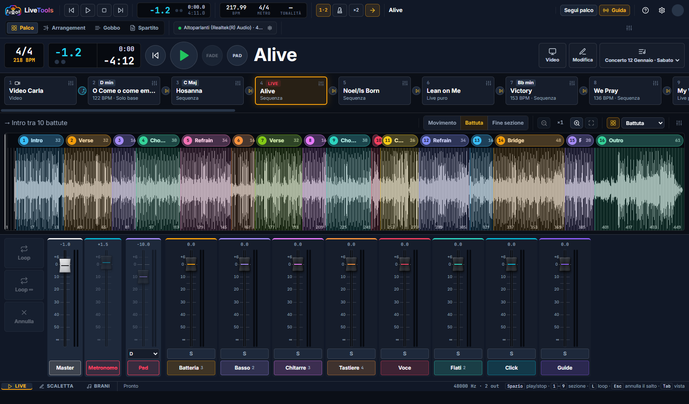

## In breve

### La prima serata in 7 passi

| # | Cosa fare | Dove | Capitolo |
|---|---|---|---|
| 1 | Installa l'app e accedi con Google | installer dal sito, poi *Accedi con Google* | 1 |
| 2 | Apri la scaletta e aggiungi i brani | pagina **Scaletta** (Ctrl+2), o dall'app web | 3.1 |
| 3 | Carica le tracce (stem) di ogni brano e scegli ruolo e gruppo Rehearsal | ispettore › *Sequenze, Video & PDF* | 3.3 |
| 4 | Scegli la scheda audio e su quali uscite vanno Main, Click, Guide, Pad | pulsante della scheda audio nella barra in alto | 4.4 |
| 5 | Scarica tutta la scaletta, così suoni senza rete | Browser › **Scarica tutta la scaletta** | 3.4 |
| 6 | Controlla che il click sia a tempo e crea le sezioni (Intro, Strofa…) | Arrangement › *Griglia*; Palco › **Modifica** | 5, 4.2 |
| 7 | Sul palco: vista **Palco**, doppio clic su una tessera, **Spazio** per partire | vista Palco | 4.2 |

Con più computer o la band in rete: chi guida preme **Guida**, gli altri **Segui palco** (4.6).

### Dove trovo…

| Voglio… | Come |
|---|---|
| partire / fermarmi | **Spazio** (stop due volte = torna all'inizio) |
| passare al brano dopo o prima | **→ ←**, oppure ⏭ ⏮ |
| saltare a una sezione mentre suono | Palco: tocca l'etichetta della sezione, o i tasti **1…9** |
| ripetere una sezione | Palco: **Loop** (una volta) o **Loop ∞** / **L** (finché non lo tolgo) |
| sfumare le tracce o accendere un tappeto | **F** (fade) e **P** (pad) |
| cambiare tonalità o tempo a un brano | Palco: pulsante con i cursori sulla tessera |
| decidere cosa succede a fine brano | Palco: cerchio tra due tessere; **Modifica › Transizioni** per regolarlo a occhio |
| regolare i volumi delle tracce | Dettaglio › **Mixer**, o **F3** in una finestra |
| mutare uno strumento (tutte le sue tracce) | nome del gruppo nel mixer del Palco, barra *Rehearsal* del Dettaglio, o **M** delle tracce nell'Arrangement |
| raddoppiare il click (ottavi) | **Maiusc+C** o pulsante **×2** |
| proiettare il video / il testo per i cantanti | **F4** (video), **F6** (gobbo); anche in rete via NDI |
| leggere lo spartito e girare pagina col pedale | vista **Spartito** (Tab) |
| comandare play, brani, loop e volumi da una pedaliera MIDI | **Ctrl+M** (MIDI learn): clicca il controllo e premi il pedale |
| cambiare i suoni delle tastiere a ogni brano | scheda **MIDI** del brano e **Ctrl+,** › **MIDI** |
| cambiare le impostazioni | **Ctrl+,**; scheda audio e opzioni del Palco nel pulsante della scheda audio |
| sapere se è tutto pronto prima di suonare | **F7** o ✓ in alto a destra (*Controllo pre-concerto*) |
| riaprire questo manuale | **F1** o **?** in alto a destra |

---

## 1. Installazione e primo avvio

1. Scarica l'installer di LiveTools per Windows dal sito [livetoolsdaw.com](https://livetoolsdaw.com), pagina
   **Desktop**.
2. Avvia l'installer (installa per tutto il computer, servono i permessi di amministratore). Se sul computer
   mancano i componenti di Windows che servono all'app (compreso **NDI 6 Runtime** per le uscite NDI), li installa
   da solo.
3. Apri **LiveTools** e accedi con Google: il login si apre nel browser, poi torna all'app.
4. Puoi usare l'app subito, con il piano Free. Le scalette condivise con te (anche tramite link di invito)
   si aprono con tutto il loro materiale, anche se appartengono a un account a pagamento.

La schermata di avvio elenca in basso il software di terze parti usato dall'app, con le sue licenze.
LiveTools per Windows è software libero sotto licenza GNU GPL versione 3: licenza e link al codice sorgente sono in
**Impostazioni › Aggiornamenti › Licenza e crediti**.

### Requisiti del computer

| | Minimo | Consigliato |
|---|---|---|
| Sistema | Windows 10 o 11 a 64 bit | Windows 11 aggiornato |
| Processore | 2 core, dal 2016 in poi (Intel Core i3 di 6ª generazione, AMD Ryzen 3) | 4 core (Intel Core i5 di 8ª generazione, AMD Ryzen 5 o superiori) |
| Memoria (RAM) | 4 GB | 8 GB |
| Disco | 2 GB liberi più lo spazio dei brani | SSD, con 10 GB o più liberi |
| Schermo | 1024 × 640 | 1920 × 1080; un secondo schermo per video o gobbo |
| Audio | le casse o le cuffie del computer | una scheda audio USB con 4 o più uscite, per mandare il click solo in cuffia |

**Quanto pesa davvero.** Misurato a novembre 2026 su un portatile con Intel Core i5-8265U (4 core) e 32 GB:

- un brano vero di 7 tracce che suona nel Palco occupa circa un terzo di un core, e l'app usa circa 300 MB di
  memoria in tutto. Da fermo, intorno al 5% di un core. Questi due valori sono quelli della prossima versione,
  più leggera: nella 0.1.13 il brano che suona occupa circa due terzi di un core e, con un'uscita NDI accesa,
  l'app da ferma resta intorno al 20%;
- ogni traccia in più aggiunge circa 0,5% di un core e 1,5 MB di memoria: tracce lette dal disco poco alla volta,
  il brano non viene mai caricato tutto in memoria;
- **256 tracce WAV** o **128 MP3** suonano senza un solo buco; cambiare brano 60 volte di fila o saltare 180
  volte in 20 secondi non interrompe l'audio e non lascia memoria occupata;
- un salto nel brano (clic sulla forma d'onda) riparte in circa 0,1 s con 16 tracce, 0,2 s con 64;
- il cambio di **tonalità o tempo** prepara 8 tracce di 4 minuti in circa 30 secondi.

I valori minimi sono una stima prudente da queste misure: un computer più lento regge comunque i brani normali
(fino a 20-30 tracce). Le viste più leggere sono Spartito e Gobbo; Palco e Arrangement ridisegnano la forma
d'onda mentre il brano suona.

**Spazio su disco per i brani.** Un minuto di traccia occupa circa 1 MB in MP3 e 10 MB in WAV. Il cambio di
tonalità o tempo crea una copia di ogni traccia di circa **23 MB al minuto** (un brano di 4 minuti con 16
tracce: circa 1,5 GB): controlla lo spazio prima di trasporre molti brani.

### Account e piano

**Impostazioni › Account** mostra il piano (Free, Plus o Pro), i brani della tua libreria rispetto al limite
del piano e, nel Pro, lo spazio occupato nel cloud LiveTools. La barra diventa gialla all'80% e rossa al
limite.

Per abbonarti premi **Plus** o **Pro** nella stessa sezione (Plus 4,99 €/mese o 39,99 €/anno, prova di 7
giorni; Pro 9,99 €/mese o 89,99 €/anno, prova di 14 giorni): si apre nel browser la pagina *Account e
abbonamento* di LiveTools web, dove paghi con Stripe. Entra con lo stesso account Google dell'app. Dopo il
pagamento il piano compare qui da solo, entro pochi secondi. Con un abbonamento attivo il pulsante diventa
**Gestisci abbonamento e fatture**. Se hai comprato dall'app Android, lo gestisci dal Play Store.

Con il **Plus** tracce e video dei tuoi brani vanno sul tuo **Google Drive**. In *Impostazioni › Account* premi
**Collega Google Drive**: si apre la pagina Account del web, dove scegli l'account Google (anche diverso da quello
dell'app). Da lì in poi i caricamenti e il Mixdown delle cue vanno su quel Drive, cartella *LiveTools*, e l'app li
scarica da lì come gli altri file. Un brano con i file sul tuo Drive si sente solo dai tuoi dispositivi.

**Piano Free: un solo dispositivo.** Con il Free l'account funziona su un solo dispositivo, quello con cui hai
cominciato (il computer, il browser o il tablet). Tracce e video restano solo lì (nella cartella dei media) e non vanno online. Da un
altro dispositivo l'app mostra *Account in uso su un altro dispositivo* e non si usa: se hai cominciato dal
computer, con lo stesso account non entri dal browser né dal tablet. Con Plus o Pro lo usi ovunque. Se cambi
computer, l'amministratore può spostare l'account sul nuovo (i file salvati solo sul vecchio restano lì).

**File audio in MP3.** Nel cloud LiveTools i file WAV, AIFF e FLAC (anche il Mixdown delle cue) vanno sempre in
**MP3 a 320 kbps**: li converte il computer prima di caricarli (la riga del caricamento dice *conversione in
MP3*; un brano di 5 minuti richiede circa mezzo minuto), il file originale resta sul disco e il brano occupa
circa un quinto. Le tracce restano allineate al campione con il click e tra loro. MP3, M4A e Ogg si caricano
come sono. Con il **Plus**, in *Impostazioni › Account* sotto Google Drive, scegli se convertirli anche per il
Drive (*Converti in MP3*, la scelta iniziale) o caricarli così come sono.

Quando l'amministratore attiva i limiti dei piani, l'app te lo dice prima di provarci:

- con il **Free**, oltre i 10 brani nella libreria non puoi crearne di nuovi (né dalla pagina **Brani** né
  aggiungendo un brano nuovo a una scaletta); puoi sempre aggiungere alle scalette i brani che hai già. Un
  brano nuovo creato nella scaletta di un altro (di cui sei editor) va nella libreria del proprietario della
  scaletta e conta nel suo piano;
- **tracce audio, video e Mixdown delle cue** vanno nel cloud solo se il proprietario del brano ha il **Pro**,
  entro i suoi 25 GB. Su un brano condiviso conta il piano del proprietario, non il tuo;
- **spartiti PDF e immagini** fino a 20 MB si caricano con tutti i piani.

### Aggiornamenti

All'avvio l'app controlla se c'è una nuova versione e la segnala nella **barra di stato**. Non installa mai
niente da sola: per aggiornare apri **Impostazioni › Aggiornamenti** (Ctrl+,) e premi *Installa la x.y.z e riavvia*. L'app si
chiude, si aggiorna e si riapre. Non aggiornare a ridosso di un concerto.

---

## 2. L'interfaccia

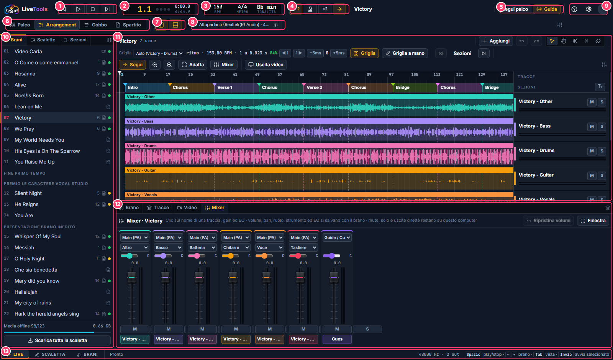

*La pagina Live con la vista Arrangement. I numeri corrispondono alla tabella qui sotto.*

| # | Area | Cosa contiene |
|---|---|---|
| 1 | **Trasporto** | ⏮ brano precedente, ⏪ torna all’inizio del brano (anche mentre suona, come **Home**), ▶ play, ■ stop (due volte = inizio), ⏭ brano successivo |
| 2 | **Posizione** | battuta.movimento grande, pallini dei movimenti (si accendono insieme al click che si sente, tenendo conto del ritardo della scheda audio), tempo trascorso e durata |
| 3 | **Tempo** | BPM, metro e tonalità del brano caricato |
| 4 | **Esecuzione** | count-in (*1·2*), click (C), click in ottavi (*×2*, Maiusc+C), auto-avanzamento (→) |
| 5 | **Band** | *Segui palco*, *Guida* e il pulsante con le persone: chi della band è collegato (vedi 4.6) |
| 6 | **Viste** | **Palco**, **Arrangement**, **Gobbo**, **Spartito** (Tab per passare da una all'altra) |
| 7 | **Pannelli** | apre e chiude Browser e Dettaglio (Ctrl+Alt+L / E) |
| 8 | **Audio** | scheda audio in uso: un clic apre *Audio & uscite* (matrice uscite, opzioni di click, scaletta e Palco) |
| 9 | **App** | ✓ controllo pre-concerto (F7), **?** manuale (F1), ⚙ impostazioni (Ctrl+,), il tuo account |
| 10 | **Browser** | tab *Brani*, *Scalette* e, nella vista Arrangement, *Sezioni*; accanto a ogni brano il numero di tracce, l'icona del video e dello spartito, un pallino verde (scaricato) o giallo (da scaricare); in fondo *Media offline* e **Scarica tutta la scaletta** |
| 11 | **Vista centrale** | la vista scelta al punto 6 |
| 12 | **Dettaglio** | tab *Brano*, *Tracce*, *Video* e (dalla prossima versione) *Mixer*: dati del brano, stato dei download, barra *Rehearsal*, anteprima video, volumi delle tracce |
| 13 | **Barra di stato** | pagine **Live** (Ctrl+1), **Scaletta** (Ctrl+2), **Brani** (Ctrl+3); messaggi dell'app e avviso aggiornamenti; a destra le scorciatoie della vista |

I pannelli intorno alla vista centrale (Browser, Dettaglio e, nelle pagine Scaletta e Brani, l'ispettore) si
chiudono e riaprono con i pulsanti nella Control bar o con **Ctrl+Alt+L / E / R**. Si ridimensionano trascinandone
il bordo; doppio clic sul bordo per tornare alla misura iniziale. Misure e stato restano su questo computer. La
vista **Palco** occupa tutta la finestra: non ha Browser né Dettaglio.

Dalla prossima versione:

- **Tab nei pannelli.** Browser e Dettaglio raggruppano i loro pannelli in tab, come in Cubase. Il pulsante accanto alle tab
  (o nell'intestazione, se sono affiancati) passa dalle tab ai pannelli affiancati e viceversa.
- **Barre di comandi.** La barra principale e quelle di Palco, Arrangement, Gobbo, Spartito, Scaletta e Brani sono divise in gruppi per categoria
  (Trasporto, Tempo, Griglia, Vista…). Quando lo spazio finisce un gruppo va a capo intero, su una nuova riga: nessun
  comando resta fuori schermo. Manuale, Impostazioni e il tuo avatar restano sempre nell'angolo in alto a destra della barra
  principale, comunque vadano a capo gli altri gruppi.
- **Personalizzare una barra.** Con il pulsante a cursori in fondo alla barra, o con un clic destro su di essa, puoi nascondere
  un gruppo, cambiarne l'ordine trascinando la maniglia e farlo partire da una *Nuova riga*. *Ripristina* torna alla
  disposizione iniziale. Puoi anche mostrare i nomi delle categorie sopra i gruppi. I gruppi indispensabili, come il Trasporto,
  non si possono nascondere. Le scelte restano su questo computer.

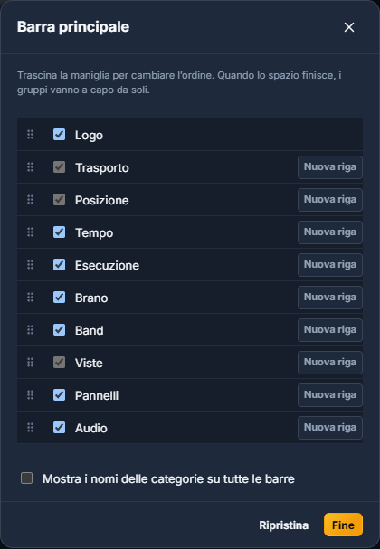

*Personalizzare la barra principale: la casella mostra o nasconde il gruppo (grigia = sempre visibile), la maniglia a
sinistra cambia l'ordine.*

### Pagine

- **Live** — il player: Palco, Arrangement, Gobbo, Spartito.
- **Scaletta** — modifica della scaletta (stessi dati del web).
- **Brani** — la libreria dei brani riutilizzabili tra più scalette.

### Menu del clic destro (dalla prossima versione)

Un **clic destro** su un elemento apre un menu con le azioni che valgono lì. Le voci che non puoi usare
(per esempio perché non hai i permessi per modificare il brano) non compaiono o sono in grigio. Il menu si
chiude con **Esc** o con un clic fuori; si usa anche con le frecce **↑ ↓** e **Invio**. Con il menu aperto
Spazio e Invio non fanno partire la musica.

| Dove | Cosa trovi nel menu |
|---|---|
| **Palco › tessera di un brano** | Seleziona, *Carica nel player*, *Carica e suona* (o Play / Stop se è già caricato), *Tonalità e tempo…* (per un video: *Dissolvenze e pad…*), *Torna a tonalità e tempo originali*, *Transizione verso…* il brano dopo, *Scarica i file* se mancano |
| **Palco › cerchio tra due tessere** | le transizioni, da scegliere direttamente: quella in uso ha la spunta |
| **Palco › sezione** (fumetto o marker) | *Vai alla sezione* (o *Annulla il salto in coda*), *Loop ∞* e *Ripeti una volta* per la sezione in corso, *Rinomina…*, *Elimina la sezione* |
| **Palco › forma d'onda** | *Sposta qui la testina*, *Aggiungi una sezione qui* o alla testina, *Modifica le sezioni*, Annulla e Salva mentre modifichi, *Griglia*, *Adatta il brano alla finestra* |
| **Arrangement › clip di una traccia** | *Taglia qui*, *Muta* / *Riattiva il segmento*, *Elimina il segmento*, poi Muto, Solo, *Taglia alla testina*, lettura e rimozione dell'automazione della traccia |
| **Arrangement › nome di una traccia** | Muto, Solo, *Taglia alla testina*, *Leggi l'automazione*, *Togli l'automazione*; sul Click: acceso/spento e cambio di tempo alla testina; sul video: *Sincronizza* e uscita video; sulle Cue: muto, quarti/ottavi, sposta tutte le cue di una battuta; sul Gobbo: sposta avanti/indietro di un movimento o di una battuta |
| **Arrangement › corsia delle sezioni** | *Vai alla sezione*, *Rinomina…*, *Elimina la sezione*, *Aggiungi una sezione qui* |
| **Arrangement › traccia cue** | *Metti una cue…* / *Cambia la cue…*, *Togli la cue*, *Conteggio 1-2-3-4 nella battuta* |
| **Arrangement › corsia Click · Tempo** | *Cambio di tempo qui*; su un cambio esistente: modificalo o toglilo |
| **Arrangement › ovunque** | *Sposta qui la testina*, Annulla / Ripeti (con il nome dell'ultima modifica), *Salva il brano* e *Scarta le modifiche* se ci sono modifiche non salvate |
| **Mixer › canale** | *Volume a 0 dB*, *Pan al centro*, Muto, Solo, lettura (R) e scrittura (W) dell'automazione, *Sezione canale (gain, EQ)…*, *Salva il brano* |
| **Browser › brano** | *Carica nel player*, *Carica e suona*, apri il brano in Palco, Arrangement, Gobbo, Spartito o nella pagina Scaletta, *Scarica i file* |
| **Browser › scaletta** | Apri, apri nel Palco, modifica la scaletta, *Scarica tutta la scaletta* |
| **Pagina Scaletta › riga** | Modifica, *Apri nel Gobbo*, Sposta su / giù / in cima / in fondo, *Elimina dalla scaletta* |

Il clic destro su una barra di comandi apre come prima la personalizzazione della barra. Nei campi di testo resta il
menu di Windows (copia, incolla).

---

## 3. Preparare una serata

### 3.1 Scaletta

Nella pagina **Scaletta**:

- scrivi il titolo in fondo all'elenco e premi Invio per aggiungere un brano; aggiungi blocchi *pausa*,
  *discorso*, *separatore*;
- riordina trascinando la maniglia; elimina con la ×;
- a destra l'**ispettore** del brano selezionato: schede *Brano*, *Palco*, *Spartito*, *Testo gobbo*,
  *Sequenze & Video*, *MIDI*, *Colonne*. Salva con **Ctrl+S** (salva anche da solo quando cambi brano o
  pagina). Sotto il titolo di ogni brano un tag indica se ha lo spartito e in che forma (*Spartito · PDF + link + accordi*, o *immagine* per una foto), oltre a *Testo* e *Gobbo*.

Ogni modifica finisce nello storico della scaletta. Il pulsante **Storico e analisi** nella barra della pagina
(dalla prossima versione) lo apre in tre schede: **Modifiche** (chi ha cambiato cosa e quando, con *Ripristina la
versione precedente*), **Versioni** (le copie della scaletta salvate da sole prima delle modifiche, al massimo ogni 30
minuti, o con *Salva versione ora*; *Ripristina* rimette la scaletta com'era e salva prima quella attuale) e
**Analisi** (ripartizione dei generi scritti nella scheda *Brano*, durata stimata, brani suonati e durata effettiva
dal via del live). Colonne personalizzate e condivisione si gestiscono dall'app web.

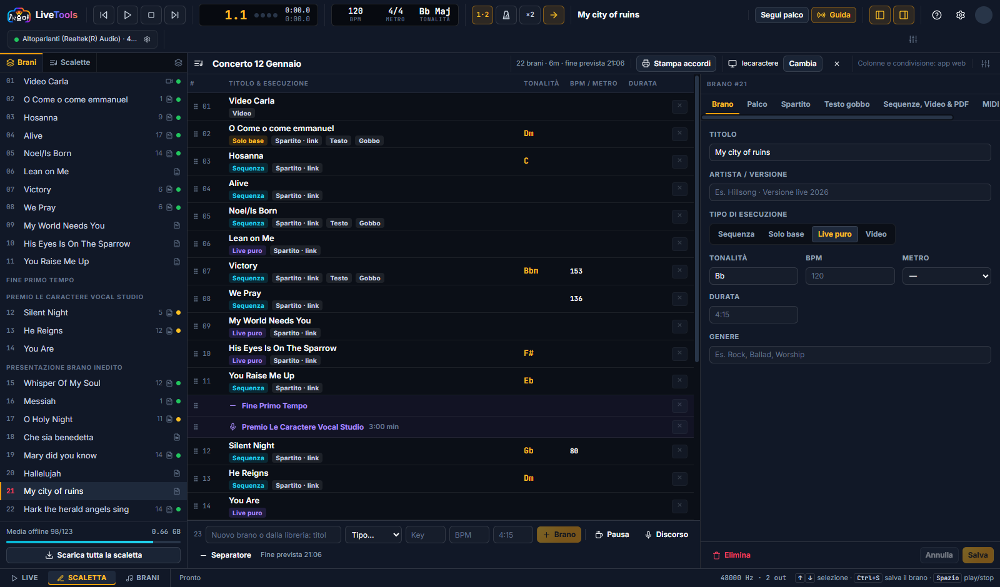

*La pagina Scaletta. Ogni riga mostra il tipo di esecuzione (Sequenza, Solo base, Live puro, Video) e i tag di
spartito, testo e gobbo; separatori e blocchi “discorso” sono in viola. In fondo la riga per aggiungere brani, pause e
discorsi; in alto **Stampa accordi** e l'immagine da proiettare (gruppo “Schermo”).*

### 3.2 Libreria brani

Nella pagina **Brani** ogni brano esiste una volta sola e può comparire in più scalette: stem, video, cue e
gobbo appartengono al brano della libreria, quindi una correzione vale ovunque.

- *Importa dalle scalette* porta nella libreria i brani già presenti nelle tue scalette (raggruppa i doppioni
  per titolo, artista e file), con tracce, video, spartito, cue e posizioni delle tracce.
- Eliminare un brano dalla libreria cancella anche le sue tracce e il suo video. Togliere un brano da una
  scaletta, invece, non cancella i file.

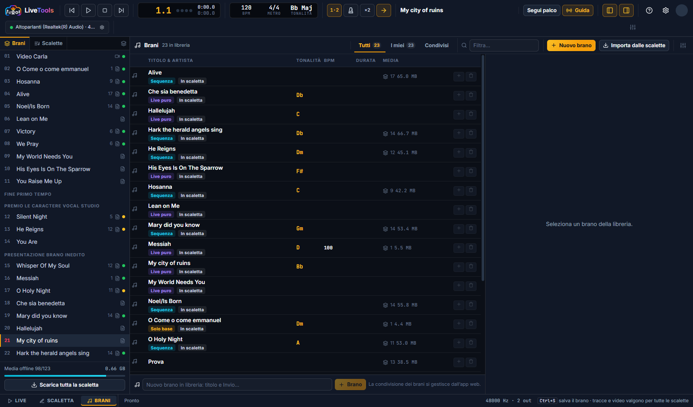

*La libreria. I filtri in alto separano i tuoi brani da quelli condivisi con te; la colonna **Media** dice quante tracce
ha il brano e quanto pesano; il tag “In scaletta” indica i brani usati nella scaletta aperta. Con **+** aggiungi il
brano alla scaletta, con il cestino lo elimini dalla libreria.*

### 3.3 Tracce e video

Scheda **Sequenze & Video** del brano (o dal web, *Sequenze & Video*): trascina i file sulla scheda o usa il
pulsante. Per ogni stem scegli:

- **Ruolo** — decide l'uscita della scheda audio: *Main*, *Click*, *Guide/Cue*, *Solo monitor*;
- **Gruppo Rehearsal** — Batteria, Basso, Chitarre, Tastiere, Voce, Cori… (serve al Rehearsal e ai gruppi del mixer
  del Palco). Se non c'è quello che ti serve scegli **+ Nuovo gruppo…** in fondo al menu e scrivi il nome (es.
  *Violino*, *Sax solista*): da quel momento il gruppo compare nel menu di ogni brano su tutti i tuoi computer, tablet e browser (si salva con il tuo account e resta anche qui, per lavorare senza rete), e chi apre il
  brano altrove lo vede comunque con il suo nome;
- nome e mute di default; l'ordine si cambia trascinando la maniglia.

Se le righe sono strette, allarga l'ispettore trascinandone il bordo.

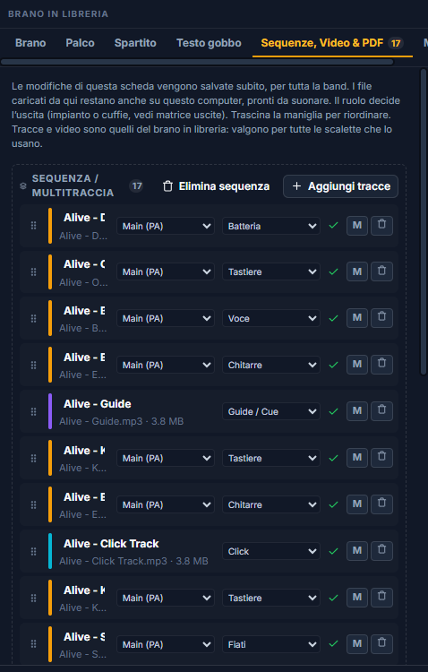

*Per ogni traccia: maniglia per l'ordine, nome e file, **ruolo** (Main, Click, Guide/Cue…), **gruppo Rehearsal**, segno di
spunta quando il file è su questo computer, **M** (mute di default) e cestino. **Aggiungi tracce** carica altri file,
**Elimina sequenza** le toglie tutte.*

Eliminare una traccia, l'intera sequenza, il video o lo spartito chiede sempre conferma e cancella il file
definitivamente dallo storage cloud (o dal Google Drive collegato), per tutta la band, e da questo computer:
la copia nella cartella media sparisce insieme ai dati ricavati dal file (forma d'onda, analisi della griglia,
versioni trasposte). Fanno eccezione i file di una scaletta duplicata, che appartengono all'originale e restano
nello storage. Gli altri computer della band tengono la loro copia finché non liberano spazio.

**Conferma prima di eliminare.** Ogni pulsante che elimina qualcosa (brani, elementi della scaletta, tracce,
video, spartiti, immagine dello schermo, sezioni, cue, cambi di tempo, slide del gobbo, patch MIDI, tasti del
pedale) chiede prima conferma. Gli strumenti di modifica dell'Arrangement (gomma, Canc) non chiedono niente
perché si annullano con Ctrl+Z e restano in bozza finché non premi *Salva*.

Per il video: un file per brano, con **offset** rispetto all'audio. Formati audio letti: wav, aiff, flac,
mp3, ogg, m4a/aac, alac. Il video è muto (la colonna sonora sta negli stem).

**Sincronizza il video** (dalla prossima versione). L'offset è il punto del brano in cui parte il video (negativo =
il video comincia prima del brano e il suo inizio non si vede). Invece di cercarlo a mano, LiveTools lo trova da
solo confrontando l'audio del video con le tracce *Main* del brano (senza click e guide), già al loro posto
nell'Arrangement: quando carichi il video di un brano con le tracce ti chiede se sincronizzarlo, e puoi farlo
quando vuoi con **Sincronizza** accanto all'offset nella scheda *Sequenze & Video* oppure con la bacchetta sulla
traccia video dell'Arrangement (lì finisce nella bozza: *Salva* per tenerlo, Ctrl+Z per tornare indietro). Il
video deve avere l'audio del brano; se la corrispondenza è incerta (brano molto ripetitivo, video con altro
audio) te lo dice e puoi correggere l'offset a mano.

**Elementi solo video** (dalla prossima versione). Un elemento della scaletta può essere solo un video, per esempio il
video d'ingresso: nella scheda del brano scegli il tipo di esecuzione **Video** e carica il video, senza stem. Qui si
sente il **suono del video** (gruppo *Video* nel mixer del Palco) e, di serie, a fine video parte subito il brano dopo
(*AutoLink*, vedi *Transizioni*). Per i dettagli vedi *Video in scaletta* nel capitolo 10.

I caricamenti continuano anche se cambi brano o pagina, e ogni file caricato è già nella cache locale.

### 3.4 Scaricare per l'offline

Prima del concerto, nel Browser premi **Scarica tutta la scaletta**: i media finiscono nella cartella media
del computer e l'app suona senza rete. Lo stato di ogni brano è visibile accanto al titolo.

Se carichi un brano che non è ancora sul computer, l'app lo scarica in quel momento: nella barra in alto compare
una barra di avanzamento con la percentuale, che sparisce appena il brano è pronto. Dalla prossima versione, finché
il brano non è pronto, al centro dello schermo compare anche un riquadro *Brano in caricamento*, con la percentuale
durante il download e una barra animata durante la preparazione. Non blocca l'app: puoi fermare o scegliere un altro
brano.

La cartella media si cambia da **Impostazioni › Generale › Posizione**: l'app sposta i file esistenti e si
ricarica.

### 3.5 Controllo pre-concerto

*Dalla prossima versione.* Prima di salire sul palco premi **F7** (o ✓ in alto a destra): un semaforo dice se si
può suonare. **Verde** è tutto pronto, **giallo** si suona ma qualcosa potrebbe mancare, **rosso** c'è da sistemare.
Sotto, una riga per ogni controllo, con accanto il pulsante che lo risolve:

| Controllo | Cosa guarda |
|---|---|
| **File dei brani** | che tracce, video e spartiti di tutta la scaletta siano sul computer; *Scarica tutto* li scarica e il controllo si aggiorna da solo. In rosso i file aggiunti solo su un altro dispositivo (Free) e i download falliti |
| **Scheda audio e uscite** | che la scheda scelta sia collegata (non quella di riserva), che click, guide, pad e monitor vadano su uscite che la scheda ha, e se ci sono stati dropout |
| **Spazio su disco** | lo spazio libero nella cartella media rispetto a quanto resta da scaricare |
| **Tastiere MIDI** | se i brani hanno patch MIDI: che un'uscita sia scelta e che ogni uscita usata sia collegata |
| **Pedale dello spartito** | se i brani hanno uno spartito: che un pedale Bluetooth sia collegato (un pedale USB funziona comunque) |
| **Uscita video** | se i brani hanno un video: che l'uscita video o quella in rete (NDI) sia accesa |
| **Modifiche non salvate** | i brani con modifiche dell'Arrangement che la band non ha ancora |
| **Rete** | internet e rete locale di palco, con quanti dispositivi sono collegati |

I controlli che non servono (per esempio il pedale, se nessun brano ha uno spartito) restano in grigio.

---

## 4. Suonare

### 4.1 Trasporto e scorciatoie

| Tasto | Azione |
|---|---|
| **Spazio** | play / stop (stop due volte = torna all'inizio) |
| **← →**, Pagina su / giù | brano precedente / successivo (pedaliere Bluetooth); nella vista Spartito girano le pagine |
| **↑ ↓** | selezione nell'elenco |
| **Invio** | avvia il brano selezionato |
| **Tab** | Palco → Arrangement → Gobbo → Spartito |
| **1 … 9** | vista Palco: salta alla sezione con quel numero |
| **L** | vista Palco: loop della sezione in corso, o esce dal loop |
| **Esc** | vista Palco: annulla il salto in coda o esce dal loop |
| **F** | vista Palco: fade delle tracce (e di nuovo per riportarle dentro) |
| **P** | vista Palco: pad acceso / spento |
| **Ins** | Arrangement: nuova sezione alla battuta della testina |
| **Home** | inizio del brano |
| **C** | click acceso / spento |
| **Maiusc+C** | click in ottavi acceso / spento (dalla prossima versione) |
| **Ctrl+1 / 2 / 3** | pagina Live / Scaletta / Brani |
| **Ctrl+Alt+L / E / R** | apre o chiude Browser / Dettaglio / ispettore |
| **F3** | mixer del brano in una finestra separata, e di nuovo per chiuderla (dalla prossima versione) |
| **F4** | uscita video accesa / spenta (dalla prossima versione) |
| **F6** | uscita gobbo accesa / spenta (dalla prossima versione) |
| **Ctrl+,** | Impostazioni |
| **F7** | controllo pre-concerto (dalla prossima versione) |
| **F1** | Questo manuale (anche dal pulsante **?** in alto) |

*Auto-avanzamento*: a fine brano prepara il successivo, se il brano non ha una transizione sua (vedi *Transizioni*
nella vista Palco).

### 4.2 Palco

Dalla prossima versione la vista **Palco** sostituisce la griglia Session: è pensata per suonare, si legge da
lontano e i comandi sono grandi anche per il touch. La disposizione è quella di Playback di MultiTracks.

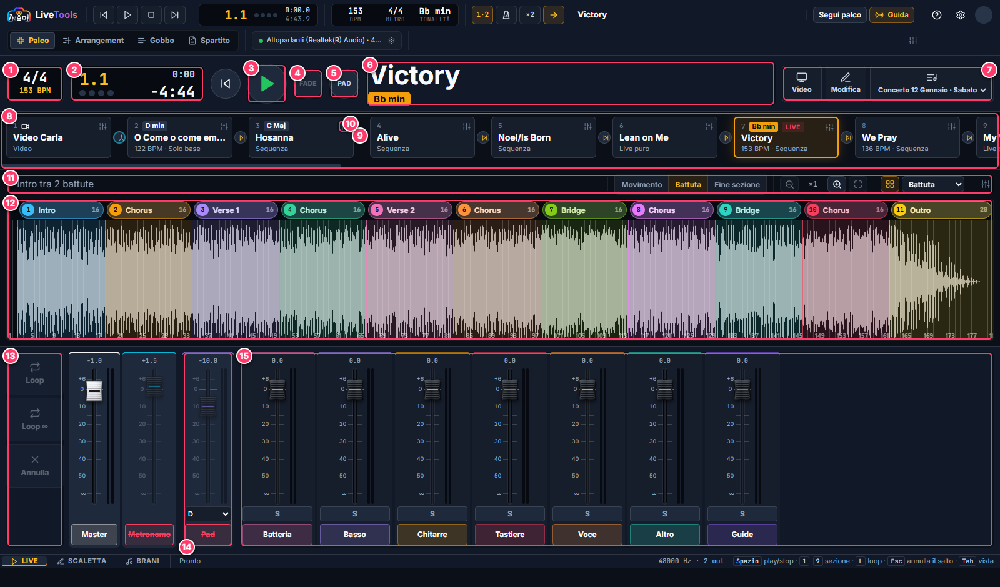

| # | Comando | A cosa serve |
|---|---|---|
| 1 | Metro e BPM | del brano caricato (con un cambio di tempo, quello del punto in cui sei) |
| 2 | Posizione | battuta.movimento con i pallini dei movimenti; tempo trascorso e tempo che manca alla fine |
| 3 | ⏮ e ▶/■ | torna all'inizio (a brano fermo); play e stop (**Spazio**) |
| 4 | **FADE** | sfuma le tracce, click e pad restano (**F**) |
| 5 | **PAD** | tappeto d'ambiente nella tonalità del brano (**P**) |
| 6 | Titolo | titolo, tonalità e artista del brano caricato |
| 7 | *Video*, *Modifica*, scaletta | uscita video (**F4**), modifica delle sezioni e pagina *Transizioni*, scelta della scaletta |
| 8 | Tessere | la scaletta: doppio clic per caricare; *LIVE* indica il brano in corso |
| 9 | Cerchio | la transizione tra i due brani: tocca per sceglierla |
| 10 | Cursori della tessera | tonalità e tempo del brano (per un video: dissolvenze e pad) |
| 11 | Barra sopra la forma d'onda | battute alla prossima sezione; quando avviene un salto (*Movimento*, *Battuta*, *Fine sezione*); zoom; griglia |
| 12 | Forma d'onda | tutto il brano diviso in sezioni: tocca un'etichetta per saltarci |
| 13 | Console | *Loop* (una volta), *Loop ∞* (**L**), *Annulla* (**Esc**) |
| 14 | Master, Metronomo, Pad | volume generale, del click e del pad, ognuno con il suo indicatore di livello; sotto il Pad il menu della sua tonalità |
| 15 | Gruppi | un fader per gruppo di strumenti: **S** = solo, tocca il nome per mutare tutte le sue tracce (metà rossa e *1/3* se solo alcune sono mutate) |

Dall'alto in basso:

- **Barra del trasporto**: metro e BPM, battuta con i movimenti, tempo trascorso e rimanente, ⏮ (torna all'inizio, a
  brano fermo), ▶/■ grande, **FADE**, **PAD**, titolo, tonalità e artista. A destra *Video* (uscita video del brano),
  *Modifica* (crea e sposta le sezioni) e il menu della scaletta.
- **Scaletta**: i brani in fila come tessere, con numero, tonalità, BPM e durata; quello caricato è evidenziato. Un clic
  seleziona una tessera, un **doppio clic** carica il brano (dalla prossima versione; prima bastava un clic). Mentre la
  musica suona il brano in corso continua: il doppio clic sugli altri non fa nulla. Dalla prossima versione una tessera con
  l'icona di download ha file non ancora su questo computer: al caricamento vengono scaricati e la tessera mostra la
  percentuale e una barra di avanzamento.
  Il cerchio tra due tessere è la **transizione** (vedi sotto). Il pulsante con i cursori in alto a destra di una
  tessera cambia **tonalità e tempo**. Attenzione: ⏮ ⏭ nella Control bar e i tasti **← →** cambiano brano subito,
  anche durante l'esecuzione.
- **Forma d'onda**: tutto il brano, con le sezioni come etichette colorate in alto (numero, nome, battute). Quella in
  corso è piena e ha a destra l'icona del loop. Tocca un punto della forma d'onda per andare alla linea della griglia più
  vicina, o alla battuta più vicina se la griglia è nascosta. Sopra leggi quante battute mancano alla sezione successiva.
  Un brano senza sezioni non ha salti né loop. Vedi *Zoom e griglia* più sotto.
- **Mixer**, in basso. A sinistra la console con *Loop*, *Loop ∞* e *Annulla*, poi master e metronomo e un fader per
  ogni gruppo di strumenti del brano caricato, gli stessi dei pulsanti *Rehearsal* (batteria, basso, tastiere, click,
  guide…). Il volume del gruppo si somma a quello delle sue tracce e resta salvato su questo computer per tutti i brani.
  Come in Playback, **tocca il nome** per mutare il gruppo (diventa rosso e barrato) o per spegnere il
  metronomo. Il Palco mostra il mute delle tracce dell'Arrangement e del Mixer: se nell'Arrangement muti una sola delle
  tre tastiere, nel Palco il nome delle Tastiere diventa rosso a metà e mostra **1/3**; toccandolo si mutano tutte,
  toccandolo di nuovo si riattivano tutte. Il mute dato dal Palco (o dal telecomando) resta su questo computer, come i
  volumi dei gruppi: non cambia il brano e non chiede di salvare; l'Arrangement e il Mixer lo mostrano, e **M** di una
  traccia lì lo toglie e torna al mute del brano; **S** mette in solo tutte le tracce del gruppo. Il metronomo ha il suo indicatore di livello (dalla prossima
  versione): vedi subito se il click sta suonando e quanto è forte. Accanto al metronomo c'è la striscia del **Pad**,
  con il suo indicatore di livello: si vede subito quando il pad sta suonando (anche mentre entra o sfuma).
  I fader sono come quelli di un mixer: cappuccio rigato con la linea nel colore della striscia (bianco per il master)
  e scala in dB accanto alla guida, da +6 a ∞ (silenzio). Doppio clic su un fader per tornare al valore di partenza.

**Fade delle tracce.** *FADE* (**F**) sfuma le tracce del brano in corso; click e pad restano. L'anello del pulsante
si svuota mentre sfuma. Premilo di nuovo (*IN*) per riportarle dentro. La durata si sceglie nella finestra **Audio &
uscite** (pulsante della scheda audio nella barra in alto), sezione *Palco* (5 secondi se non la cambi). Stop o cambio brano riportano le tracce a pieno volume.

**Pad.** *PAD* (**P**) accende un pad d'ambiente generato dall'app, come l'Ambient Pad di Playback: suona anche a
brano fermo, sull'uscita *Pad* della matrice (finestra *Audio & uscite*) e con il master. Entra e esce in pochi secondi.
Nel mixer, il menu della striscia sceglie la tonalità:

- *Brano*: segue la tonalità del brano caricato (cambio di tonalità compreso). Quando cambia brano il pad passa alla
  nuova tonalità con una dissolvenza, così può fare da tappeto tra un brano e l'altro.
- una tonalità precisa (*C*, *Db*, …): resta quella, qualunque brano carichi.

Il nome *Pad* accende e spegne, il fader ne regola il volume. Con **Audio & uscite › Palco › Accendi il pad quando parte
un brano** il pad si accende da solo al play. Se il brano non ha una tonalità, scegline una nel menu.

**Transizioni.** Come in Playback, il cerchio tra due tessere dice cosa succede alla fine del brano. Toccalo (serve
poter modificare la scaletta) e scegli; la scelta vale per tutta la band:

- ⏭ *Prepara il prossimo*: a fine brano carica il successivo senza farlo partire.
- ■ *Resta nel brano*: a fine brano resta caricato questo.
- ▶ *AutoLink*: il successivo parte appena finisce questo, senza buchi.
- *Sovrapponi*: il successivo parte a pieno volume sull'ultima parte di questo, la più corta tra l'ultima sezione,
  la prima sezione del successivo e 5 secondi. Questo prosegue fino alla sua fine.
- *Dissolvenza*: negli ultimi 5 secondi questo sfuma mentre il successivo entra.
- *Come l'auto-avanzamento*: la scelta predefinita. Segue l'opzione *Auto-avanzamento* di questo computer
  (prepara il prossimo se è accesa, resta nel brano se è spenta). Per un elemento *Video* la scelta predefinita è
  invece *AutoLink* (dalla prossima versione).

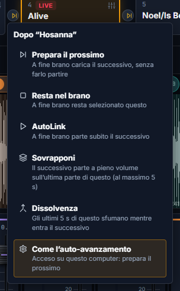

*Il menu che si apre toccando il cerchio tra due tessere. La scelta evidenziata è quella in uso.*

Con *AutoLink*, *Sovrapponi* e *Dissolvenza* il brano successivo viene preparato appena carichi quello prima. Quando il
cerchio diventa pieno, l'app è pronta a fare la transizione. Il successivo parte dall'inizio (o dalla sezione scelta
nella pagina *Transizioni*), senza count-in. Se non si riesce a prepararlo (per esempio perché è offline e non è
scaricato), a fine brano viene solo caricato.

**Pagina Transizioni** (dalla prossima versione). In **Modifica** il pulsante **Transizioni** della barra sopra la
forma d'onda apre tutta la scaletta su una linea del tempo, per vedere e regolare a occhio come un brano passa
all'altro. Serve poter modificare la scaletta per cambiarle; tutti possono provarle.

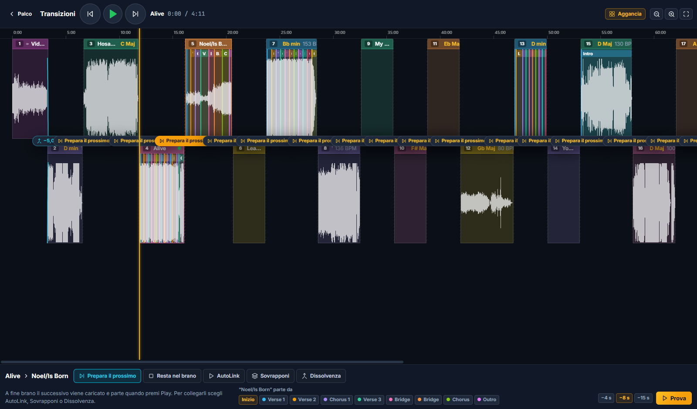

*Tutta la scaletta nella finestra (pulsante con le frecce in alto a destra). La linea gialla è la testina.*

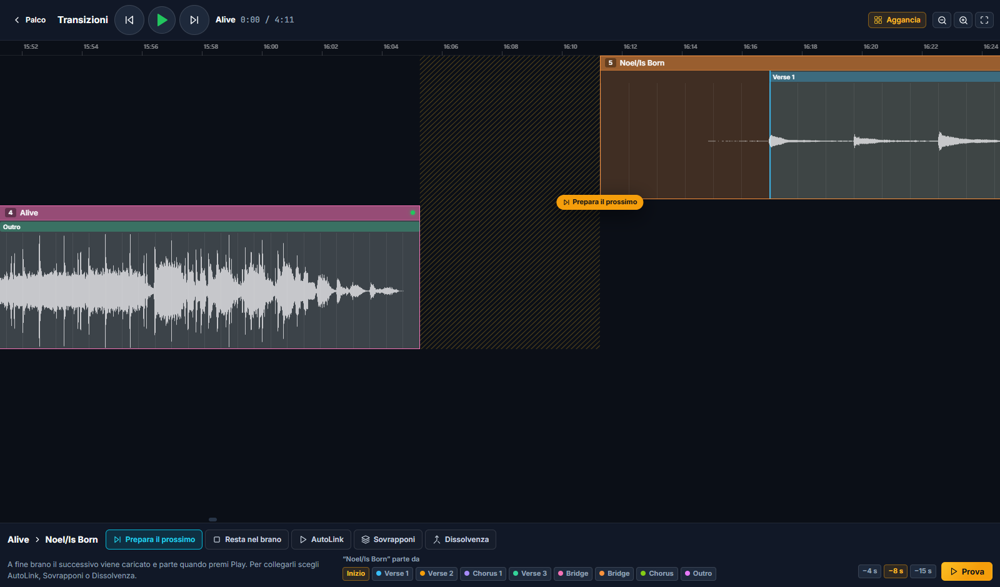

*Un passaggio ingrandito: il brano prima (sotto) finisce, la fascia a righe è la pausa prima del brano dopo (sopra). Nel
pannello in basso il tipo di transizione, la sezione da cui parte il brano dopo e **Prova**.*

- I brani stanno su **due corsie** che si alternano, così dove il successivo entra sopra la fine del precedente si vede
  la sovrapposizione (fascia azzurra) e dove c'è una pausa una fascia a righe. Ogni brano mostra la **forma d'onda**
  di tutte le sue tracce insieme e le **sezioni** colorate, come nel Palco; i brani non ancora scaricati hanno
  l'icona di download (toccala per scaricarli e vedere la forma d'onda).
- Il cerchio tra i due brani dice tipo e posizione della transizione (*−4,0 s* = il successivo entra 4 secondi
  prima della fine, *+2,0 s* = due secondi di pausa). Toccalo per sceglierla.
- **Trascina il brano dopo** a sinistra per sovrapporlo, a destra per lasciare una pausa (fino a 30 s). Con
  **Aggancia** acceso entra sulle battute del brano prima. Oltre la fine diventa *AutoLink* con pausa, sopra la fine
  *Sovrapponi* (una *Dissolvenza* resta tale).
- Le **linee azzurre** sono il volume: il **quadratino bianco** regola quanto sfuma il brano prima (*Uscita*), quello
  **azzurro** quanto cresce il successivo (*Entrata*). La forma d'onda si abbassa di conseguenza, e la parte del
  brano che non si sente più resta in grigio.
- Il **bordo arancione** all'inizio del brano dopo si trascina per farlo partire più avanti (per esempio saltando
  l'intro): si aggancia alle sue battute. Nel pannello sotto, *“…” parte da* sceglie direttamente la sezione.
- Il **pannello** in basso ha il tipo, i valori con − e + (anche di una battuta alla volta), la sezione di partenza e
  **Prova**: carica il brano prima, va a 4, 8 o 15 secondi dalla transizione e la suona come avverrà dal vivo
  (**Invio**). *Valori del tipo* toglie le regolazioni.
- **← →** (o i pulsanti ⏮ ⏭) passano alla transizione prima o dopo; se la musica sta suonando la provano subito. Un
  tocco su un brano o su una sezione porta lì la testina; la rotella scorre, **Ctrl + rotella** (o due dita sul
  tablet) cambia lo zoom, il pulsante con le frecce mostra tutta la scaletta. **Esc** torna al Palco.

Le regolazioni valgono per tutta la band e si salvano subito, come il tipo di transizione. Durante una pausa il click
tace. Per gli elementi *Video* la timeline mostra anche quando entra il **pad** (corsia viola in basso).

**Immagine e monitor** (dalla prossima versione). Se la scaletta ha dei video, ogni brano mostra sopra la forma
d'onda una striscia con quello che va sull'uscita video: i fotogrammi del suo video (più scuri dove l'immagine sfuma,
con la sua linea rosa) oppure *Immagine della scaletta* o *Schermo nero*. Immagine e audio stanno nello stesso
blocco e si spostano insieme.
L'immagine di un elemento *Video* continua sopra il brano dopo fino alla sua fine, anche se il suono è già sfumato.
Il pulsante **Monitor** in alto mostra accanto al pannello una piccola uscita video, che segue la testina e **Prova**.

**Immagine e audio separati.** Per un elemento *Video* immagine e suono hanno ciascuno **entrata**, **uscita** e
**fine**. Di serie vanno insieme; si regolano trascinando le maniglie rosa (immagine, nella striscia in alto) e
azzurre tonde (audio, sulla forma d'onda) — il **bordo** a destra di ciascuna è la fine — oppure con − e + nel riquadro del
video nel pannello. Toccare l'audio lo separa dall'immagine (*Separati*); **Insieme** lo fa tornare a seguirla.
Così puoi, per esempio, sfumare l'immagine sul logo mentre l'intervista continua a sentirsi, o sfumare l'audio
lasciando l'immagine fino alla fine. L'elemento dura quanto il più lungo dei due: se accorci entrambi, il brano dopo
parte prima.

**Tonalità e tempo.** Il pulsante con i cursori di una tessera cambia la tonalità (fino a 6 semitoni sopra o sotto) e il
tempo (fino a 20 BPM in più o in meno, se il brano ha un BPM) del brano in questa scaletta, come in Playback. Le tracce si
rielaborano una volta su ogni computer, alla prima apertura. Mentre l'app lavora la barra in basso mostra quante ne ha
fatte, e il risultato resta salvato accanto ai file. Click, guide e cue cambiano solo il tempo, non la tonalità.
Griglia, sezioni, cue, gobbo e video restano allineati: tutto segue il nuovo tempo. *Originale* toglie le modifiche.
Sulle tessere un BPM con l'asterisco è cambiato, una tonalità bordata di viola è cambiata. Cambia tonalità o tempo a
brano fermo: se il brano sta suonando, la rielaborazione lo interrompe per qualche secondo. Sul web il brano si
sente ancora nella tonalità e nel tempo originali.

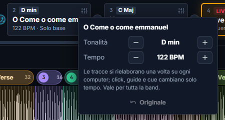

*Tonalità e tempo di un brano: − e + di un semitono o di un BPM alla volta.*

**Zoom e griglia.** I comandi sono nella barra sopra la forma d'onda, anche mentre modifichi le sezioni, e le scelte
restano salvate su questo computer.

- **−** e **+** (o **Ctrl+rotella** sulla forma d'onda, o due dita su uno schermo touch) cambiano lo zoom fino a ×32; il pulsante accanto riporta tutto il
  brano nella finestra. Con lo zoom la forma d'onda scorre con la rotella o con la barra sotto. A brano in corso segue la
  testina, e dopo uno scorrimento a mano riprende a seguirla dopo 3 secondi.
- Il pulsante della griglia mostra o nasconde le linee con i numeri di battuta. Il menu accanto sceglie la risoluzione:
  *8*, *4*, *2 battute*, *Battuta* o *Movimento*. Se le linee sono troppo fitte ne vedi meno: aumenta lo zoom per vederle tutte.
- La griglia guida il tocco sulla forma d'onda. A brano in corso si arriva al massimo sulla battuta, anche con la risoluzione
  *Movimento*, per non spostare gli accenti rispetto alla musica. Le sezioni partono sempre da una battuta: **+** e il
  trascinamento dei marker non cambiano con la risoluzione.

**Salti.** A brano in corso, tocca l'etichetta di una sezione: il salto va in coda, l'etichetta lampeggia e la musica
arriva lì senza buchi e a tempo con il click. Scegli quando avviene con *Movimento*, *Battuta* o *Fine sezione*. Un
altro tocco sulla stessa etichetta (o *Annulla*, o **Esc**) annulla. A brano fermo il tocco sposta subito la testina.

**Loop.** Come in Playback ce ne sono due, nella console del mixer:

- *Loop* ripete **una volta** la sezione in corso: alla fine torna al suo inizio, poi la musica prosegue.
- *Loop ∞* (**L**, o l'icona del loop sull'etichetta della sezione in corso) la ripete finché non lo premi di nuovo:
  la musica arriva alla fine della sezione e poi continua.

Toccare un'altra sezione esce dal loop e salta lì. Stop e cambio brano annullano salti e loop.

**Creare le sezioni sulla forma d'onda.** Premi **Modifica** nella barra del trasporto (serve poter modificare la scaletta): la forma d'onda si
ingrandisce fino a quando non premi *Fine* nello stesso punto. Un tocco sulla forma d'onda sposta solo la testina e non crea sezioni.

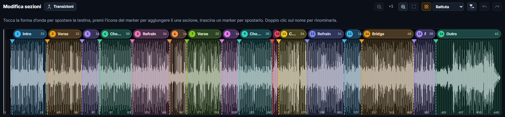

*In modifica ogni sezione ha un marker (triangolo colorato) all'inizio. A destra nella barra: zoom, griglia e
risoluzione, **+** (aggiungi un marker alla testina), annulla e ripeti.*

- Porta la testina dove serve e premi **+**: il marker si aggancia alla battuta più vicina. Il primo marker su un brano
  vuoto crea anche *Intro*, perché la prima sezione parte sempre dalla battuta 1.
- Trascina un marker per spostarlo da una battuta all'altra, senza superare quelli vicini.
- Tocca un marker o l'etichetta di una sezione per scegliere la sezione e usa i nomi pronti (*Intro*, *Verse*, *Pre-Chorus*,
  *Chorus*, *Bridge*, *Solo*, *Interlude*, *Outro*). Per scrivere un nome tuo fai **doppio clic** sul campo del nome
  (appena aggiunto un marker il campo è già pronto): **Invio**, **Esc** o un clic altrove lo chiudono, così i tasti della
  vista non lo sovrascrivono. *Elimina* la toglie e le sue battute passano alla sezione prima.
- **Ctrl+Z** annulla, **Ctrl+Shift+Z** ripete. Le modifiche restano su questo computer finché non premi **Salva**, come nell'Arrangement; poi
  valgono per tutta la band.

Le stesse sezioni si modificano anche nella pagina **Scaletta**, scheda **Brano**, *Cambi di tempo*: lì puoi dare a una
sezione un tempo o un metro diversi. Se una sezione cambia il tempo, spostarne il marker sposta anche il cambio.

**Sul web.** L'app web ha un *Player palco* con sezioni, salti, loop, fade e pad. Le sezioni si creano qui. Quando
carichi un brano, e se puoi modificare la scaletta, il desktop salva con la scaletta anche le battute della sua griglia:
così i salti del web cadono sulle stesse battute. Transizioni, tonalità e tempo ci sono solo qui.

I marker non toccano le **cue**: la griglia resta la stessa e le cue già create, live o renderizzate, restano dove sono.
Se il brano ha delle cue, la vista Palco rifiuta solo le modifiche che cambierebbero davvero il tempo, come spostare o
eliminare una sezione con un tempo proprio.

### 4.3 Arrangement

Timeline del brano caricato: righello in battute, corsia delle sezioni, forme d'onda, corsie video, click e
cue, testina che segue. Header delle tracce con M/S e meter (dalla prossima versione volume e uscita sono nel **Mixer**, vedi sotto).

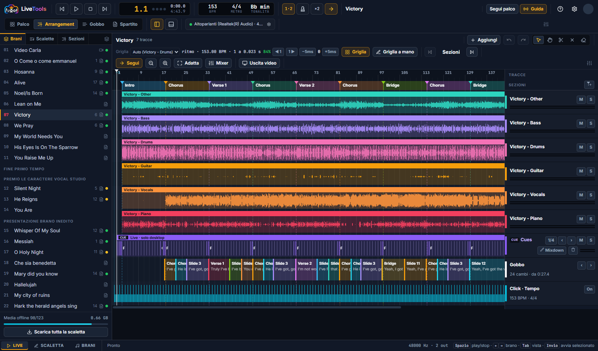

*L'Arrangement con il Dettaglio chiuso (Ctrl+Alt+E). In alto: menu della griglia (traccia di riferimento, BPM,
posizione del "1"), le icone **Aggancia alla griglia** e **Griglia a mano** (gruppo *Griglia*; dalla prossima versione solo icone), il menu **Scena**, **Segui**, zoom, **Adatta**, **Mixer**, **Uscita video**, e a
destra **Aggiungi**, annulla/ripeti e gli strumenti (freccia, mano, forbici, muta, gomma). Sotto le tracce audio: la
traccia **cue**, la traccia **Gobbo** e il **Click**.*

Dalla prossima versione sotto il righello c'è la **corsia delle sezioni**, come la Marker Track di Cubase, con gli stessi
colori della vista Palco:

- **clic** su una sezione: ci vai. A brano in corso il salto avviene senza buchi, nel momento scelto nella vista Palco
  (*Movimento*, *Battuta* o *Fine sezione*). Anche i pulsanti ⏮ ⏭ del gruppo *Sezioni* spostano da una all'altra;
- **trascina l'inizio** di una sezione per spostarlo, a battute;
- **doppio clic** per rinominarla;
- **Ctrl+clic**, per aggiungerne una in quel punto. **Ins** o il **+** nell'intestazione *Sezioni* la aggiungono alla testina.

La tab **Sezioni** del Browser, visibile solo in questa vista, mostra l'elenco, con numero, nome e battuta di partenza: il
numero porta alla sezione, il nome si scrive direttamente nella riga, la × elimina, **Aggiungi** ne crea una alla battuta
della testina. Le modifiche si salvano con **Salva**.

**Quando chiede di salvare** (dalla prossima versione). Cambiare brano non chiede niente: i brani con modifiche restano segnati con un pallino nell'elenco, e le modifiche si sentono già su questo computer. LiveTools chiede di salvarle solo quando **cambi scaletta** (anche dal telecomando) o **chiudi il programma**: compare l'elenco dei brani non salvati con **Salva tutto**, **Non salvare** (le scarta; alla chiusura *Chiudi senza salvare*) e **Annulla** (resti dove sei).

**Salvare senza connessione** (dalla prossima versione). **Salva** funziona anche quando il computer o il tablet non
è collegato a internet: il brano resta salvato su questo dispositivo e nella barra compare *In attesa di rete*. Appena
torna la connessione le modifiche arrivano da sole alla band, anche se nel frattempo hai chiuso e riaperto l'app. Se
il server non le accetta (per esempio perché nel frattempo il brano è stato eliminato) compare un avviso e le modifiche
tornano *Non salvate*, così non si perde niente.

**Ctrl+rotella** = zoom; pulsanti *Segui la testina* e *Adatta alla finestra*. Il primo pulsante della barra, **⏮
Inizio**, riporta la testina e la vista all'inizio del brano, anche mentre suona (come il tasto **Home**). La barra di
scorrimento orizzontale sta sempre in fondo alla vista, sotto le tracce: resta visibile anche con il Dettaglio aperto
o con tante tracce.

**Mixer** (dalla prossima versione). Nel Dettaglio, tab **Mixer**, oppure in una finestra separata come la MixConsole di
Cubase: **F3** o il pulsante **Mixer** della barra dell'Arrangement (di nuovo F3 per chiuderla). Una striscia per **ogni traccia del
multitraccia**, nell'ordine della sequenza, più la traccia cue live e, per un elemento video, l'**Audio del video** (volume, pan, mute, gain ed EQ salvati con il video); le tracce non ancora scaricate compaiono sbiadite e
senza meter, ma si possono già regolare. Dalla prossima versione la prima striscia è il **Click di sistema** (il metronomo
di LiveTools) con il suo indicatore di livello. Il **fader** e **M** valgono per il brano e si salvano con lui come quelli
delle tracce (*Non salvato* finché non premi **Salva**, **Ctrl+Z** annulla): per esempio un click più basso in una
ballata o nessun click in un brano libero, su ogni computer, tablet e nella prova sul web. Il volume del brano si somma
a quello del click di questo computer (Palco, **Impostazioni**). L'uscita e il **nome** (acceso o spento, come **C**)
restano invece di questo computer, per tutti i brani:

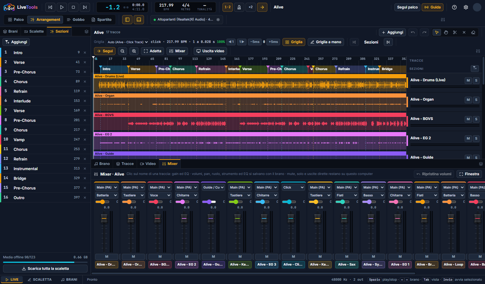

*Il mixer nel Dettaglio (tab **Mixer**) e, a sinistra, la tab **Sezioni** del Browser con numero, nome e battuta di
ogni sezione. In alto a destra **Ripristina volumi** e **Finestra** (F3).*

- in alto il **menu della destinazione**, come in Cubase: il **ruolo** (*Main (PA)*, *Click*, *Guide / Cue*, *Solo
  monitor*, gli stessi della vista Sequenze della scaletta, che escono dove dice la matrice uscite) oppure un'**uscita
  diretta** di questo computer;
- sotto, per Main e Solo monitor, il **gruppo Rehearsal** (Batteria, Basso, Tastiere…, o uno tuo con **+ Nuovo
  gruppo…**): come nelle Sequenze, il Rehearsal di chi lo suona toglie la traccia dal mix;
- **pan**, **fader del volume** con meter (doppio clic: 0 dB / centro), **M** e **S**;
- il **nome** in fondo apre la **sezione canale** della traccia (accanto resta la sua striscia; di nuovo clic sul nome,
  **✕** o **Esc** per tornare al mixer, **‹ ›** per passare alla traccia vicina). Come su un banco digitale:
  - **Gain** d'ingresso (±24 dB), prima dell'EQ, con il meter;
  - **EQ** a 5 bande più **passa alto** e **passa basso** (12 dB/ottava). Il grafico mostra la curva sopra lo
    **spettro della traccia** mentre suona (le frequenze in uso, dopo l'EQ). Si trascina un punto: in orizzontale la
    frequenza, in verticale il guadagno (±15 dB); la **rotella** sul grafico stringe o allarga la campana (Q); doppio clic
    = banda a 0 dB, oppure passa alto/basso acceso/spento. Sotto, i pulsanti **HP 1 2 3 4 5 LP** scelgono la banda e i
    cursori **Freq**, **Gain** e **Q**; ogni banda può essere **Campana**, **Shelf basso** o **Shelf alto** (lo shelf
    non ha Q). **EQ** esclude e riattiva tutto (per il confronto), **Piatto** azzera.
  - Una traccia con gain o EQ modificati ha il segno **EQ** sul nome.

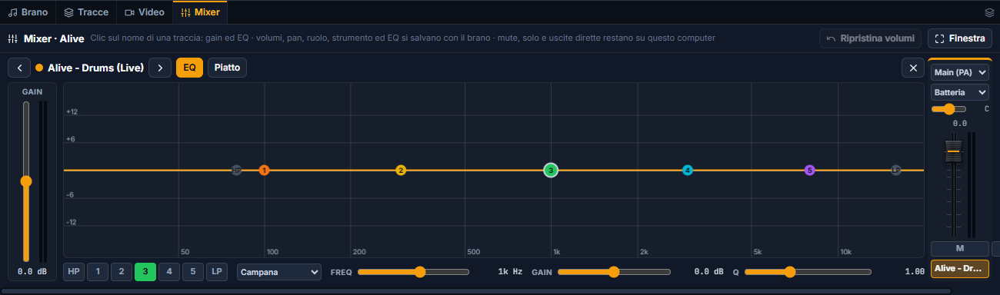

*La sezione canale: **Gain** a sinistra, il grafico dell'EQ con un punto per banda, sotto la banda scelta con tipo,
**Freq**, **Gain** e **Q**; a destra resta la striscia della traccia.*

Volume, pan, ruolo, gruppo Rehearsal, gain ed EQ si salvano **con il brano** (pulsante **Salva**, anche nel mixer): al prossimo caricamento, su ogni
computer della band e nella prova sul web, il brano suona così. Si annullano con Ctrl+Z nell'Arrangement (un trascinamento
del fader = un passo). **Ripristina volumi** riporta tutte le tracce a 0 dB e pan al centro (gain ed EQ restano: si azzerano con **Piatto**), poi Salva. Solo e
l'uscita diretta restano solo su questo computer. Chi non può modificare il brano vede i volumi ma non li cambia.

**Mute delle tracce salvato con il brano** (dalla prossima versione). Il mix della performance dal vivo si prepara una
volta e si ritrova uguale: anche **M** delle tracce, nel Mixer e nell'intestazione delle tracce dell'Arrangement, va nel
brano (*Non salvato* finché non premi **Salva**, **Ctrl+Z** annulla) e vale su ogni computer, tablet e nella prova sul web,
insieme a volumi, pan e automazioni. Chi non può modificare il brano usa ancora un mute solo suo, su questo dispositivo.
Il mute e i volumi dei gruppi dati dal Palco, dalla barra *Rehearsal* o dal telecomando invece restano personali, su
questo computer, e non chiedono di salvare (vedi *Rehearsal*).

**Precount**: battute di count-in prima della battuta 1, uguali per tutti i brani; si impostano in **Impostazioni › Trasporto** e si sentono con il count-in attivo.

### Scene del mix (dalla prossima versione)

Una **scena** è una versione del mix che vale per **tutti i brani**: per esempio *Base* (il mix salvato di ogni brano),
*Live con la band* (mutati i canali degli strumenti che i musicisti suonano dal vivo) o *Tutto aperto* (nessun mute).
La scena attiva si sceglie dal menu **Scena** nella barra dell'Arrangement, nell'intestazione del **Mixer** (anche nella
finestra F3), nella barra in alto del **Palco** (accanto alla scaletta) e dal **telecomando**. Cambiarla è immediato,
anche a brano in corso.

Il pulsante a fianco del menu (o *Gestisci le scene…*) apre la finestra delle scene:

- **Nuova scena**: scrivi il nome e premi **+**; la scena nuova diventa quella attiva;
- **Muta in tutti i brani**: tocca i gruppi Rehearsal (Batteria, Basso, Chitarre…) da mutare in ogni brano della scena;
- **Parti senza mute**: nella scena suonano anche le tracce che nei brani sono mutate (le automazioni del mute restano);
- **Togli le modifiche di “brano”**: il brano caricato torna alle sole regole della scena;
- **Elimina** la scena (chiede conferma).

Con una scena attiva, quello che cambi nel mix di un brano (**M**, volume, automazioni di volume e mute, **R**) vale **solo
per quella scena**: si salva nel brano con **Salva**, come le altre modifiche, e il mix *Base* non cambia. Le scene sono
del tuo account: le ritrovi su ogni computer e tablet con cui accedi. La scena attiva è di ogni dispositivo. Il web
suona sempre il mix *Base*.

### 4.4 Audio e uscite

Dal pulsante della scheda audio nella control bar: scegli il dispositivo e la **matrice uscite**, cioè su
quali canali escono Main, Click, Guide e Monitor. L'uscita si può cambiare per singola
traccia e resta salvata su questo computer; volume e (dalla prossima versione) mute di ogni traccia si regolano nel **Mixer** e si salvano con il brano
(vedi *Arrangement*). Le uscite che la scheda non ha ricadono su Out 1-2 (comodo
per provare sul portatile).

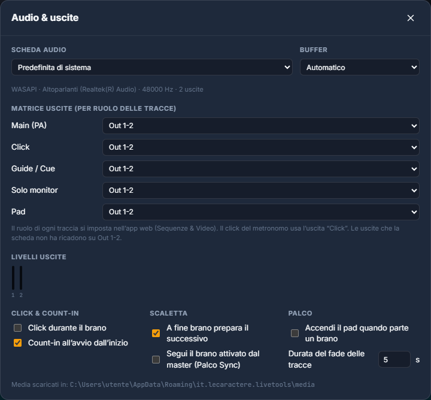

*La finestra **Audio & uscite**. In basso tre gruppi di opzioni rapide: “Click & count-in”, “Scaletta”
(auto-avanzamento e “Segui palco”) e “Palco” (pad automatico e durata del fade).*

**Schede collegate e scollegate a programma aperto.** Quando colleghi una nuova scheda audio, LiveTools apre
questa finestra con l'avviso *Nuova scheda audio collegata*: **Usa questa scheda** la sceglie subito, altrimenti
chiudi e resta quella di prima. Se la scheda in uso viene scollegata (o Windows la disattiva), il brano si ferma
dov'era e l'audio passa da solo all'uscita **predefinita di sistema**; la barra di stato dice cosa è successo.
Ricollegando la scheda compare di nuovo l'avviso per riprenderla.

Tutto questo si può spegnere con la casella **Rileva le schede audio collegate e scollegate** in questa finestra
(dalla prossima versione). Da spenta non compaiono avvisi e la scheda non cambia mai da sola: se quella in uso si
scollega, il suono si ferma e scegli tu un'altra scheda qui.

Di base LiveTools usa l'audio standard di Windows: la scheda resta disponibile anche per gli altri programmi.
Se la scheda ha un driver **ASIO®** (dalla prossima versione), lo trovi nel gruppo **ASIO** dell'elenco delle
schede: il suono arriva prima e con meno ritardo, la frequenza di campionamento è quella impostata nel pannello del
driver e, di solito, nessun altro programma può usare la scheda nel frattempo. Se il driver scelto non è
disponibile all'apertura (scheda scollegata o occupata) LiveTools mostra l'errore nella barra di stato: scegli
un'altra scheda per tornare a suonare.

*ASIO is a registered trademark of Steinberg Media Technologies GmbH.*

### 4.5 Rehearsal

Nella barra *Rehearsal* del dettaglio (brano caricato) un clic muta tutte le tracce di un gruppo (Batteria, Basso,
Click, Guide…), un altro le riattiva; se solo alcune sono mutate il pulsante lo mostra (*1/3*). Arrangement, Mixer e
Palco mostrano sempre lo stesso stato delle tracce. Il mute dato qui o dal Palco resta su questo computer e non cambia
il brano (niente *Salva*); **M** di una traccia nell'Arrangement o nel Mixer lo toglie da quella traccia e torna a quello
del brano. Il metronomo si spegne dalla sua striscia nel Palco o con **C**. I fader dei gruppi nel mixer del Palco sono
**personali**: ogni musicista si fa il suo ascolto sul suo dispositivo e non cambia il mix del brano salvato per la band.

### 4.6 Suonare con la band (Palco Sync)

- **Guida** — il brano caricato qui diventa quello attivo per tutta la band (serve essere proprietario,
  editor o palco della scaletta).
- **Segui palco** — carica il brano attivato dal master (dal web o da un altro desktop).

**Anche senza internet (dalla prossima versione).** Se computer e tablet della band sono sulla stessa rete
Wi-Fi, per esempio il router del palco, il brano passa direttamente da chi ha **Guida** a chi ha **Segui
palco**, senza internet. Non c'è niente da configurare: si trovano da soli quando hanno la stessa scaletta.

- Su chi segue, accanto a *Segui palco* compare **LAN** quando è collegato a chi guida. Passandoci sopra
  vedi a chi è collegato e il ritardo della rete in millisecondi.
- Su chi guida, accanto a *Guida* compare **LAN** con il numero di chi è collegato. L'elenco con ruolo e
  ritardo è anche in **Ctrl+,** › **Rete locale**.
- La prima volta Windows chiede se consentire LiveTools sulle reti private: rispondi **Consenti**.
- In **Ctrl+,** › **Rete locale** scegli il **ruolo sul palco** con cui ti vede la band. Se il router blocca la
  ricerca, scrivi a mano l'**indirizzo** che compare su chi guida.
- Con internet il brano passa anche dal cloud come sempre. I telefoni con l'app web ricevono il brano e il
  gobbo solo dal cloud.
- **Leggio (dalla prossima versione).** Chi guida manda in rete locale anche il **gobbo** del brano caricato:
  su LiveTools Mobile, menu ⋯ › *Leggio del gobbo*, cantanti e musicisti lo leggono a tutto schermo come su un
  leggio, slide per slide a tempo con la musica, anche senza *Segui palco* e senza internet. Lo stesso dal
  **Telecomando** (pulsante *Leggio*).

**Chi è collegato (dalla prossima versione).** Il pulsante con le persone accanto a *Guida* mostra quanti altri
della band hanno aperta la stessa scaletta. Un clic apre l'elenco: nome, ruolo sul palco, dispositivo e come è
collegato (**LAN** = rete di palco, nuvola = internet), con il ritardo. Chi guida può premere **Invia ping** per
controllare che tutti ricevano i comandi: accanto a ognuno compare il tempo di risposta. Anche questo computer
compare nell'elenco *Palco Sync* dell'app web.

Con *Segui palco* o *Guida* accesi, se qualcuno della band si scollega compare un avviso in basso
(*“Marco (Batteria) si è scollegato da Palco Sync”*), così te ne accorgi prima del brano dopo.

**Computer di riserva (dalla prossima versione).** Un secondo computer può suonare in contemporanea con quello di
chi guida, pronto a sostituirlo se si blocca:

1. Su entrambi la stessa scaletta e i brani già scaricati (**F7** lo controlla).
2. Sulla riserva: **Ctrl+,** › **Rete locale** › **Computer di riserva** › *Questo computer è la riserva*, poi
   **Segui palco** (accanto compare **RISERVA**). *Guida* deve restare spenta.
3. Sul principale: **Guida**, come sempre.

La riserva carica lo stesso brano, parte, si ferma e salta insieme al principale (anche loop e salti di
sezione), e si riallinea da sola se resta indietro di qualche centesimo di secondo. Le sue uscite vanno a un
commutatore audio o restano pronte da collegare: se il principale si blocca, basta passare alla riserva, che sta già
suonando.

Se il principale sparisce dalla rete mentre suona, la riserva continua e avvisa. Con l'opzione *Se il principale
sparisce dalla rete, guida la band al suo posto* (accesa all'inizio) la riserva accende **Guida** da sola, così
tablet e altri computer seguono lei. Quando il principale torna, spegni *Guida* sulla riserva e premi di nuovo *Segui
palco*.

**Telecomando dal telefono o dal tablet (dalla prossima versione).** Con LiveTools Mobile puoi comandare questo
computer da lontano, per esempio dal centro del palco mentre il computer è vicino al mixer. Funziona solo se
computer e telefono sono sulla **stessa rete Wi-Fi**; internet non serve.

1. Sul computer: **Ctrl+,** › **Rete locale** › **Telecomando** › *Accetta il telecomando*. Compare un
   **codice** di 4 cifre e l'indirizzo del computer.
2. Sul telefono o tablet: menu **⋯** › **Telecomando** (o il pulsante *Telecomando* nell'elenco delle scalette).
   Il computer compare da solo: toccalo e scrivi il codice. La volta dopo si ricollega da solo. Se il router
   blocca la ricerca, scrivi a mano l'indirizzo.

Dal telecomando puoi: **Play / Stop**, brano precedente e successivo, tornare all'inizio; vedere la scaletta e
**caricare** un brano (tocca il brano, poi *Carica* o *Carica e avvia*); cambiare scaletta (a brano fermo);
saltare alle **sezioni**, **Loop 1×**, **Loop ∞**, *Annulla salto* e **Fade**; aprire e chiudere le finestre
**Video** e **Gobbo**; accendere e spegnere **click**, ottavi, count-in, avanzamento automatico e **pad**; il
**Mixer** del computer (dalla prossima versione), su una schermata a parte: tutte le tracce del brano come nel Mixer dell'Arrangement (volume, pan, destinazione, gruppo Rehearsal, M, S, R/W, gain ed EQ toccando il nome), modifiche nella bozza del brano come qui, con **Salva** nella colonna a sinistra; scegliere la vista del computer (Palco, Arrangement, Gobbo, Spartito).
Il telecomando mostra il brano caricato, il tempo che scorre, la battuta e le sezioni colorate.

In **Rete locale** vedi i telecomandi collegati e il loro ritardo; quando uno si collega o si scollega compare un
avviso in basso. Chi prova con un codice sbagliato non comanda niente (e compare un avviso). **Cambia codice**
scollega tutti: dovranno scrivere quello nuovo. La musica suona sempre dal computer, il telefono manda solo i comandi.

### 4.7 MIDI: suoni giusti a ogni brano (dalla prossima versione)

LiveTools può cambiare da solo i suoni di tastiere ed effetti a ogni brano.

**Nel brano** (ispettore della scaletta, scheda **MIDI**) scrivi una riga per ogni strumento:

- **Strumento** e **nome patch** (per esempio *Nord Stage 3* · *Piano & Pad*);
- **Ch** è il canale MIDI, **PC** il numero del suono (da 1 a 128), **MSB** e **LSB** il banco, se lo strumento
  lo usa;
- **CC**, se servono altri comandi, nella forma *numero=valore* separati da virgole: `7=100, 91=40` porta il volume
  a 100 e il riverbero a 40;
- **SysEx**, per i comandi propri di uno strumento, in esadecimale da `F0` a `F7` (anche più messaggi di fila).
  I valori li trovi nel manuale dello strumento.

Se un valore non va bene, sotto la riga compare in rosso cosa correggere.

**Su questo computer** (**Ctrl+,** › **MIDI**):

- **Uscita**: l'interfaccia MIDI o la tastiera collegata con il cavo USB. **Aggiorna** la cerca di nuovo se l'hai
  collegata dopo. Con *rtpMIDI* anche il MIDI in rete compare qui come le altre uscite;
- **Cambio patch automatico**: i suoni cambiano quando un brano diventa quello nel player, cioè quando lo carichi,
  lo scegli nel Palco o arriva con una transizione. Se lo stesso brano si ricarica (cambi di tonalità, di tempo o
  delle cue) non vengono rimandati, così il suono non si interrompe mentre suoni;
- **Uscita di ogni strumento**: gli strumenti dei brani della scaletta. Ognuno può andare su un'altra uscita oppure
  su *Non inviare da questo computer*, per esempio quando il tastierista cambia i suoni dal suo computer o tablet;
- **Invia ora** manda subito i suoni del brano nel player: comodo per provare i collegamenti.

I suoni cambiano allo stesso modo anche dal tablet e dall'app web (Chrome o Edge).

### 4.8 MIDI learn: comandare LiveTools da un controller (dalla prossima versione)

Una pedaliera, dei pad o dei fader MIDI possono comandare i controlli di LiveTools: play, brano dopo,
salto a una sezione, loop, fade, pad, volumi.

1. Collega il controller e premi **Ctrl+M**, oppure il pulsante con la **nota** in alto a destra. I controlli che
   puoi assegnare si illuminano e in basso compare la barra **MIDI learn**.
2. Clicca un controllo, per esempio **Play** o il fader **Master**.
3. Premi un tasto, un pedale o muovi un fader sul controller: il comando è assegnato e sul controllo compare
   il messaggio (per esempio *Nota C4/1* o *CC 7/1*).
4. Ripeti con gli altri controlli, poi premi **Fine** o **Esc**.

Da quel momento il tasto fa quello che farebbe un clic: un pedale accende e spegne il click, un fader del
controller muove il fader del mixer. Le tessere della scaletta caricano il brano (se nessun brano sta suonando),
le etichette delle sezioni ci saltano.

- Per cambiare un comando, in MIDI learn scegli il controllo e premi un altro tasto; **Canc** o **Rimuovi** lo
  toglie. Un tasto comanda un solo controllo: se lo assegni a un altro, il primo lo perde.
- **Ctrl+,** › **MIDI** elenca i controlli assegnati (con la × per toglierli) e gli **Ingressi** da ascoltare:
  tutti, o solo quelli che scegli. Gli ingressi si aprono solo quando c'è almeno un controllo assegnato.
- Le assegnazioni restano su questo computer: ogni musicista ha il suo controller.

---

## 5. Click e griglia

### 5.1 Il click

Il click è generato dal motore (nessun campione): **Impostazioni › Trasporto** per suono (Beep, Woodblock,
Cowbell, Stick, HiHat), volume, e volume / intonazione di accento, movimenti, suddivisioni e count-in. Il
count-in segue le stesse regole del metronomo web, con cambi di tempo e metro per sezione.

**Click in ottavi** (dalla prossima versione): il pulsante **×2** del trasporto, **Maiusc+C** o
**Impostazioni › Trasporto › Click in ottavi** raddoppia il click: nei tempi semplici (4/4, 3/4…) suona anche
i controtempi, cioè il 4/4 in ottavi, un po' più piano dei movimenti (regolabili con la voce *Ottavi* di
volume e intonazione). Nei tempi composti (6/8, 12/8) il click è già in ottavi e non cambia; il count-in resta
in quarti.

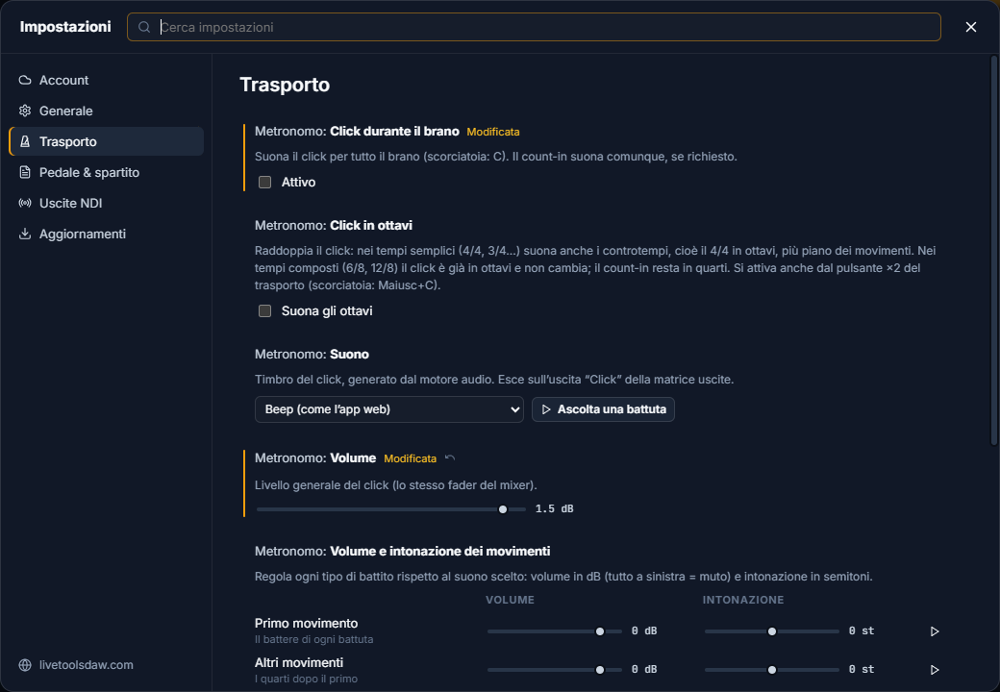

*Impostazioni › Trasporto. “Modificata” segna le voci cambiate rispetto all'inizio; la freccia accanto le riporta al
valore iniziale. Il pulsante ▶ di ogni riga fa sentire quel colpo.*

### 5.2 Griglia allineata all'audio

Al caricamento l'app allinea click, count-in e righello alle tracce:

- **con una traccia click** (ruolo Click o nome "click"/"metronomo"): la griglia segue i colpi battuta per
  battuta, cambi di tempo compresi;
- **senza traccia click**: analizza una traccia ritmica (batteria, perc, loop… o la prima Main) attorno al
  BPM del brano e trova dove cade il "1".

Il menu **Griglia** nell'Arrangement mostra traccia usata, BPM rilevato, posizione del "1" e affidabilità;
permette di scegliere un'altra traccia, usare i *Dati del brano*, spostare il "1" di un movimento (◀ 1 / 1 ▶)
e correggere di ±5 ms.

Dalla prossima versione, quando l'affidabilità è sotto il 50% (succede quasi solo senza traccia click: un mix
senza batteria, un tempo che accelera o rallenta) al caricamento compare l'avviso *Griglia incerta* e il menu
**Griglia** mostra *incerta: controllala*. Ascolta il click: se non cade a tempo, scegli un'altra traccia di
riferimento o fissa la griglia a mano (**W**). Con gli ancoraggi a mano l'avviso non compare più.

Dalla prossima versione, se l'audio comincia una battuta o più prima del "1" trovato (succede quando la traccia
di riferimento entra dopo un intro, o con *Analisi da / a*), all'apertura nell'Arrangement la battuta 1 torna
all'inizio dell'audio: la griglia resta a tempo con la musica e conta le battute dall'intro, invece di lasciarlo
prima della battuta -1. Cue e sezioni già create si spostano con lei e restano sulla stessa musica. La
correzione è *Non salvata*: **Salva** per tenerla, **Ctrl+Z** per annullarla. Non tocca le griglie fatte a mano.

### 5.3 Griglia a mano (tasto W)

Per chi può modificare la scaletta. L'audio non cambia: è la griglia che si adatta.

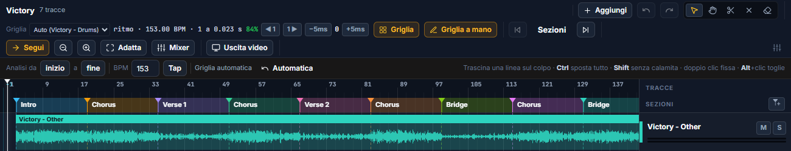

*Con **Griglia a mano** acceso compare la barra sotto la Control bar: analisi “da / a”, **BPM**, **Tap**,
**Automatica**; a destra il promemoria di Ctrl, Shift, doppio clic e Alt+clic.*

- **Analisi da / a**: limita l'analisi al tratto con ritmo utile (es. dopo un intro libero).
- **Ancoraggi**: trascina una linea di battuta o movimento sul colpo giusto. Ctrl sposta tutta la griglia,
  Shift toglie la calamita sui transienti, doppio clic fissa una linea, Alt+clic toglie un ancoraggio.
- **BPM** e **Tap** (almeno 3 colpi) per scrivere o battere il tempo.
- **Automatica** torna all'analisi.

La griglia è salvata sul brano: vale su tutti i computer della band.

### 5.4 Cambi di tempo e di metro nel brano (dalla prossima versione)

Per i brani che cambiano tempo (un ritornello più veloce, un rallentando nel finale) la traccia **Click · Tempo**
dell'Arrangement fa da traccia del tempo, come in Cubase (dalla prossima versione accanto al tempo c'è anche
l'indicatore di livello del click):

- **doppio clic** sulla corsia, o il **+** nella sua intestazione (alla battuta della testina), aggiunge un cambio di
  tempo sulla battuta più vicina, al tempo che il brano ha lì;
- ogni cambio è una **bandierina** con il BPM (♩ 90); un clic la apre: scrivi i **BPM** e scegli **Arriva**
  *subito* o *gradualmente in 1, 2, 4, 8, 16 battute* (rallentando o accelerando, il click cambia colpo per colpo);
  **Togli** lo elimina;
- nella stessa finestra **Metro** cambia anche la divisione delle battute da lì in poi (per esempio da 4/4 a 6/8,
  o un 2/4 di una battuta sola seguito da un altro cambio che torna a 4/4). Lasciando i **BPM** vuoti cambia solo il
  metro e il tempo resta quello di prima; la bandierina mostra entrambi (♩ 90 · 6/8). Nei tempi composti (6/8, 12/8)
  i BPM contano la semiminima puntata, come nelle sezioni;
- **trascina** la bandierina per spostarla su un'altra battuta;
- la linea bianca nella corsia mostra il tempo lungo il brano.

L'audio non cambia: si spostano click, count-in, griglia, righello e le cue, che restano sulle battute. Come le altre
modifiche dell'Arrangement i cambi sono *Non salvati* finché non premi **Salva** e si annullano con **Ctrl+Z**; salvati,
valgono su tutti i computer, sul tablet e sul web. *Aggiungi → Battute…* sposta anche i cambi che vengono dopo.

Quando la griglia segue una **traccia click** colpo per colpo, o gli **ancoraggi** della griglia a mano, è già quella a
dare i cambi di tempo: finché c'è, i cambi della corsia non si sentono (lo dice anche la loro finestra).

---

## 6. Modificare l'arrangiamento

Strumenti nella barra dell'Arrangement (tasti **1–6**):

| Tasto | Strumento | Uso |
|---|---|---|
| 1 | Selezione | seleziona la traccia; trascinando un bordo accorcia il segmento (l'audio resta dov'è) |
| 2 | Sposta | trascina il segmento intero, da qualsiasi punto (con *Griglia* attiva il suo inizio si aggancia ai movimenti, Shift inverte) |
| 3 | Taglia | taglia dove clicchi |
| 4 | Muta | muta / riattiva un segmento |
| 5 | Elimina | elimina un segmento |
| 6 | Automazione | disegna la curva del volume della traccia o del click e i tratti in cui tace (dalla prossima versione, vedi sotto) |

Altre azioni: **Ctrl+E** taglia la traccia selezionata alla testina, **Canc** elimina, **X** muta,
**Ctrl+Z / Ctrl+Shift+Z** annulla / ripeti.

**Più tracce insieme** (dalla prossima versione). Con *Selezione* o *Sposta*, **Ctrl+clic** su un nome di traccia o
su un segmento lo aggiunge alla selezione (un altro Ctrl+clic lo toglie); **Maiusc+clic** seleziona tutte le tracce
dall'ultima cliccata fino a quella (sulla stessa traccia, i segmenti in mezzo). Poi, con **Sposta** (tasto **2**),
trascina uno dei segmenti selezionati: si muovono tutti della stessa quantità (una traccia selezionata per intero
si sposta con tutti i suoi segmenti). È un solo passo di **Ctrl+Z**. Un clic senza tasti torna a una sola selezione.
Taglia, Canc e X agiscono ancora sull'ultima cliccata.

**Aggiungi → Battute…** inserisce battute vuote alla battuta della testina: sposta in avanti stem, cue,
ancoraggi della griglia, cambi del gobbo e sezioni.

**Automazione del volume** (dalla prossima versione). Con lo strumento **Automazione** (tasto **6**) ogni traccia mostra
la sua linea del volume, gialla, sopra le clip:

- **clic** nella corsia aggiunge un punto all'altezza scelta e lo puoi già trascinare; con *Griglia* attiva il punto si
  aggancia ai movimenti (Shift inverte);
- **trascina** un punto per cambiarne tempo e livello: in alto +6 dB, a circa 4/5 dell'altezza il volume del fader
  (0 dB), in basso il silenzio;
- **trascina la linea** tra due punti per alzarla o abbassarla tutta insieme (prima del primo punto e dopo l'ultimo
  sposti il livello che resta); un clic sulla linea, senza trascinare, ci aggiunge un punto;
- **Alt+trascina** disegna la curva a mano, dove passa il mouse: i punti sotto il tratto disegnato vengono sostituiti,
  il resto della curva non cambia;
- **doppio clic** o **Alt+clic** su un punto lo toglie; con la traccia selezionata, **Canc** toglie tutta la sua automazione.

Tra due punti il volume cambia gradualmente; prima del primo e dopo l'ultimo resta il loro. La curva si somma al fader
del Mixer e alla sezione canale. Con gli altri strumenti la linea resta visibile, più chiara. Si salva con il brano
(**Salva**, Ctrl+Z annulla), la suonano Palco, Arrangement, tablet e la prova sul web, ed è legata al tempo del brano:
non segue lo spostamento delle clip, ma *Aggiungi → Battute…* sposta i punti che vengono dopo.

**Automazione del mute** (dalla prossima versione). Una traccia può anche tacere in alcuni tratti del brano e
riprendere da sola: i tratti muti si vedono scuri, con una riga rossa sotto il nome. Con lo strumento **Automazione**,
**Ctrl+clic** nella corsia muta la traccia da quel punto (o la riattiva, se lì è già muta) fino al cambio successivo;
**trascina** il triangolino rosso di un bordo per spostarlo; **Ctrl+clic** sul bordo lo toglie. **Canc** con la traccia selezionata toglie
tutte le sue automazioni, volume e mute. Durante l'esecuzione la **M** si accende da sola nei tratti muti (a righe,
per distinguerla dal mute fisso della traccia, che resta più forte di tutto).

**R e W, lettura e scrittura delle automazioni** (dalla prossima versione), come in Cubase. Nell'intestazione di ogni
traccia dell'Arrangement e sotto M e S di ogni striscia del Mixer:

- **R** (verde) *legge* le automazioni: volume e mute seguono le curve. Spenta, le curve restano nel brano (tratteggiate)
  ma la traccia suona al suo fader. Si salva con il brano, quindi vale per tutta la band; è accesa da sola appena una
  traccia ha un'automazione.
- **W** (rossa) *scrive*: mentre il brano suona, premi **M** e il cambio di mute viene scritto in quel punto; afferra il
  **fader** nel Mixer e il volume viene scritto finché lo tieni, poi torna alla curva che c'era (come il modo *Touch* di
  Cubase). Il fader e la M seguono la curva mentre il brano va, così vedi cosa stai sovrascrivendo. Ogni gesto è un
  passo di Ctrl+Z e va nella bozza: **Salva** per tenerlo. W resta solo su questo computer e si spegne alla chiusura
  dell'app: non rischi di scrivere per sbaglio durante il concerto. Accendere W accende anche R.

R e W ci sono per chi può modificare il brano; la traccia cue dal vivo e l'audio del video non hanno automazioni.

**Automazione del click** (dalla prossima versione). Anche la traccia **Click · Tempo** ha la sua automazione, con **R**
e **W**: la **curva del volume**, per esempio per abbassare il click in una strofa piano e rialzarlo nel ritornello, e i
**tratti senza click**, per fermarlo alla fine del brano e lasciare il tempo libero (un finale rallentato, una corona).
Il click tace nei tratti segnati in rosso e riparte da solo dove finiscono; il count-in suona sempre, al suo volume.

- con lo strumento **Automazione** la corsia del click si modifica come quella di una traccia: clic aggiunge un punto
  del volume, si trascinano punti e linee, **Alt+trascina** disegna a mano, doppio clic toglie un punto; la curva si
  somma al volume del click delle Impostazioni;
- **Ctrl+clic** nella corsia ferma il click da quel punto (o lo fa ripartire, se lì è già fermo); trascina il
  triangolino rosso per spostare un bordo, **Ctrl+clic** sul bordo lo toglie; con *Griglia* attiva i punti si
  agganciano ai movimenti;
- oppure con **W** accesa: mentre il brano suona, **On** ferma o fa ripartire il click in quel punto;
- clic destro sul nome *Click · Tempo* → *Togli l'automazione del click*.

Con lo strumento Automazione le bandierine dei cambi di tempo si modificano con gli altri strumenti.

**On** resta l'interruttore del click per tutti i brani (Impostazioni › Click); nei tratti fermati dall'automazione
appare a righe. Il tratto si salva con il brano (**Salva**), vale per tutta la band e anche nella prova sul web, e
*Aggiungi → Battute…* lo sposta insieme alla musica.

**Traccia Gobbo** (dalla prossima versione). Se il brano ha i cambi del gobbo registrati, nell'Arrangement c'è la
traccia **Gobbo**: un blocco per slide, del colore della slide, fino al cambio dopo. Se il brano è cambiato dopo
aver registrato il gobbo (per esempio hai spostato le tracce per un'intro più lunga), **trascina la traccia** per
riallineare tutti i cambi insieme: con *Griglia* attiva si aggancia ai movimenti (Shift inverte). I pulsanti **‹ ›**
nell'intestazione spostano tutto di un movimento (con Shift di una battuta). Come le altre modifiche
dell'Arrangement lo spostamento è *Non salvato* finché non premi **Salva**, e **Ctrl+Z** lo annulla; le slide e la
registrazione restano quelle, cambia solo dove cadono.

Dalla prossima versione un brano parte sempre dal suo primo audio o dalla battuta 1, se viene prima: il vuoto che
li precede viene tolto e il brano si sposta indietro con griglia, cue, gobbo e video. Le battute tra il "1" e
l'audio restano, così un conteggio parlato sulla traccia cue ha il suo spazio; altre battute vuote all'inizio
restano solo se le inserisci con *Aggiungi → Battute…*. Vale anche per i brani già salvati con un vuoto:
all'apertura nell'Arrangement la correzione è *Non salvata*, quindi la tieni con **Salva** o la annulli con
**Ctrl+Z**.

I file audio non vengono mai riscritti: l'app salva solo dove suonare ogni pezzo. Il video si sposta solo se
il taglio è prima del suo inizio.

---

## 7. Traccia cue (guide vocali)

Utile quando un brano non ha una traccia guida.

1. **Aggiungi → Traccia cue** nell'Arrangement.
2. La corsia è divisa in quadratini (quarti o ottavi per battuta): clicca un quadratino e scegli la cue
   ("Strofa", "Ritornello", "Bridge", conteggi…).
3. Hai sbagliato battuta? Dalla prossima versione, con la **freccia**, trascina il quadratino di una cue sul quadratino
   giusto: la cue si sposta lì (se c'era già un'altra cue, la sostituisce). Un clic senza trascinare apre il menu
   come prima. **Ctrl+Z** annulla lo spostamento.
4. La **mano** sposta tutte le cue insieme trascinando (dalla prossima versione non apre il menu: per inserire usa un
   altro strumento), la **gomma** ne cancella una. Dalla prossima versione l'intera traccia cue si sposta anche
   trascinando la sua barra colorata in alto (quella con "CUE") con qualsiasi strumento, o con i pulsanti **‹ ›**
   nell'intestazione: un quadratino alla volta, con **Maiusc** una battuta.

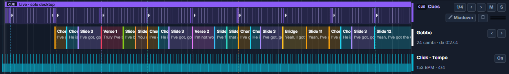

*In alto la traccia **cue** (barra viola “CUE · Live · solo desktop”), con a destra la suddivisione (“1/4”), ‹ ›, M,
S, **Mixdown** e il cestino; sotto la traccia **Gobbo** (24 cambi) e la traccia **Click**.*

Le cue si sentono subito come traccia *live*, generata su questo computer. Dalla prossima versione il pulsante
**Mixdown** nell'intestazione della traccia cue le trasforma in una vera traccia audio "Cues", caricata online:
compare nell'Arrangement come le altre tracce (con forma d'onda, M e S) e si sente anche dal web. Appena la
traccia audio è pronta, la traccia cue viene **mutata per tutta la band** (pulsante **M** acceso, corsia sbiadita)
e la traccia audio è attiva; premi **Salva** per tenere il muto. Il muto della traccia cue vale per tutti i
computer e per il web, non solo per il tuo: lo togli o lo rimetti con **M** nell'intestazione o nel Mixer.

Se modifichi le cue dopo il mixdown, con la traccia cue muta senti ancora la traccia audio di prima: la corsia lo
segnala ("da aggiornare") e un nuovo **Mixdown** la rifà. Il pulsante con la nuvola elimina la traccia audio e
riattiva la traccia cue. Il Rehearsal e il Player palco del web generano da soli la traccia cue quando non è
muta, sulla griglia pubblicata dal desktop: si sente nel gruppo *Guide* anche senza traccia audio.

Le cue non possono stare nel count-in (lì c'è solo il click). Le cue si creano solo dal desktop. Dalla prossima
versione la prima cue parte sempre dalla battuta 1.1: se la battuta 1 è finita un poco prima dell'inizio del brano
(tracce allineate a mano), all'apertura nell'Arrangement il brano viene riportato a posto.

---

## 8. Gobbo (testo sincronizzato)

Vista **Gobbo** (Tab):

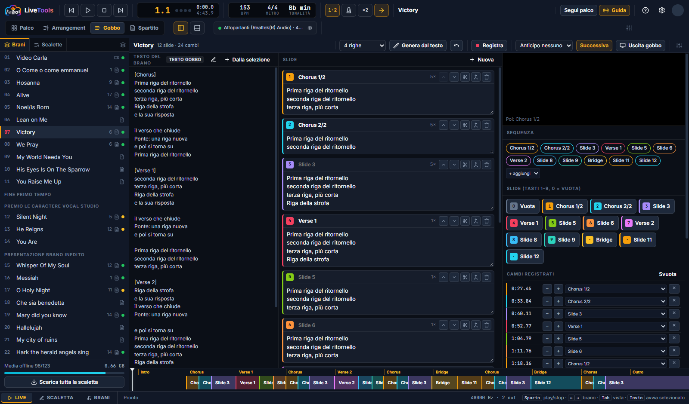

*Da sinistra: il **testo del brano**, le **slide** (ognuna con numero, nome, quante volte compare, ↑ ↓, dividi, unisci,
elimina), poi l'anteprima dell'uscita, la **sequenza**, i pulsanti delle slide (tasti 1–9, 0 = vuota) e l'elenco dei
**cambi registrati** con i loro tempi. In basso la timeline con le sezioni e i cambi. Il testo nella figura è di
esempio.*

1. **Suddividi il testo** — *Genera dal testo* divide il *Testo gobbo* del brano in slide di 2, 3, 4, 6 righe
   o a blocchi. I blocchi ripetuti (il ritornello) diventano una sola slide che compare più volte nella
   sequenza. Le slide si possono rinominare, modificare, dividere, unire, riordinare.
2. **Registra i cambi** — premi **Registra** (R), poi play; clicca la slide (o **1–9**, **0** = schermo vuoto)
   al momento del cambio, oppure **Invio / ↓** per la successiva. Allo stop i nuovi cambi sostituiscono i
   vecchi nel tratto suonato; Ctrl+Z annulla.
3. **Ritocca** — trascina i cambi nella timeline o spostali di ±50 ms nella lista. Per spostarli tutti insieme
   (il brano ora ha un'intro più lunga) usa la traccia *Gobbo* dell'Arrangement (dalla prossima versione).

**Indicazioni e colori (dalla prossima versione).** Sotto il testo di ogni slide:

- **+ Indicazione** aggiunge un'etichetta colorata che compare sul gobbo sopra il testo della slide (fino a 4):
  *Voce femminile*, *Voce maschile*, *Tutti*, *Solo*, *Coro*, *Finale*, *Rallenta*, *Ripeti*, *Strumentale*,
  *Stop*, oppure una tua con il colore che scegli. Le tue tornano tra le proposte delle altre slide del brano.
  La × sull'etichetta la toglie. Si vede anche sulla slide successiva, in piccolo.
- **Colora la selezione** — seleziona delle parole nella slide e premi un colore: sul gobbo quelle parole
  appaiono in quel colore, per dividere le parti (chi canta cosa). Con **Evidenzia** acceso le parole hanno
  invece lo sfondo colorato. Nel testo della slide vedi i segni `[rosa]…[/]` e `[evid rosa]…[/]`: puoi
  anche scriverli a mano (colori: rosa, blu, viola, ambra, azzurro, rosso, arancio, verde, giallo).
  **Togli colori** li toglie tutti dalla slide.

Indicazioni e colori si vedono ovunque arrivi il gobbo: finestra di uscita, NDI, app web, Leggio di telefoni e
tablet.

**Uscita gobbo** apre una seconda finestra per lo schermo dei cantanti, con la
slide successiva in piccolo e un anticipo regolabile. Lo stesso gobbo può andare in rete come sorgente
**NDI** (vedi *10. Video*).

Con **Guida** attivo il gobbo arriva anche a telefoni e tablet: nell'app web, pulsante **Gobbo** della
scaletta.

---

## 9. Spartito e pedale

Carica lo spartito del brano nella scheda **Spartito** dell'ispettore (pagina Scaletta o Brani): **Carica
spartito** o trascina il file. Va bene un **PDF** o una **foto/scansione** della pagina (jpg, png, webp; da
LiveTools 0.1.11 — fino alla 0.1.10 solo PDF, e solo dalla scheda *Sequenze, Video & PDF*, dove lo trovi ancora). Si può
caricare anche dall'app web e dall'app tablet. Il file si salva subito per tutta la band e, come stem e video,
viene scaricato su questo computer e funziona offline.

Il campo **Link spartito** resta: se il brano ha uno spartito caricato l'app mostra quello, altrimenti la
vista Spartito offre **Apri il link dello spartito**, che lo apre nel browser.

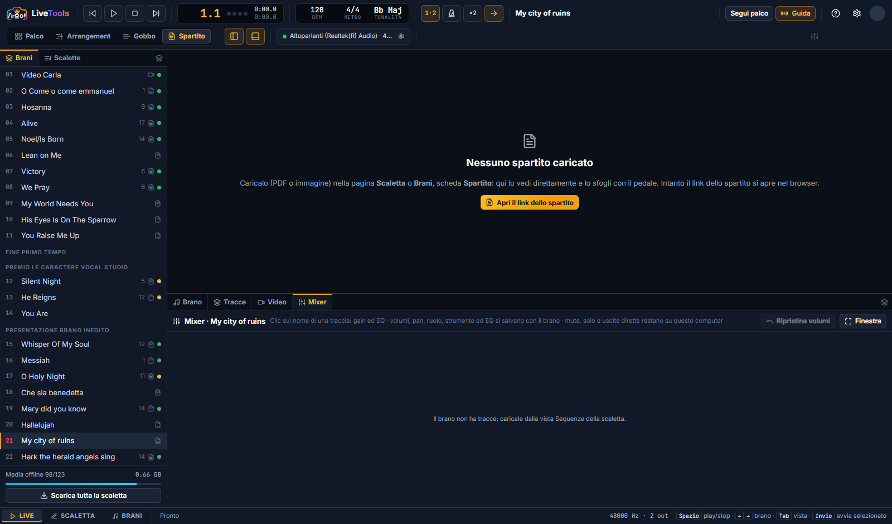

*La vista Spartito di un brano senza file caricato ma con il link: il pulsante lo apre nel browser. Con un PDF o
un'immagine caricati, qui compare la pagina.*

Vista **Spartito** (Tab): una pagina, o due affiancate quando la vista è larga (*Automatico*). Le pagine si
girano con:

- un **pedale / telecomando Bluetooth** volta-pagine (AirTurn, PageFlip, Donner, iRig BlueTurn…): si abbina
  come una tastiera da *Impostazioni di Windows › Bluetooth e dispositivi*. Di default **Pagina giù**, **→**,
  **↓** = pagina successiva e **Pagina su**, **←**, **↑** = precedente; in questa vista non cambiano brano;
- un clic sulla pagina (terzo sinistro = indietro), **Home** / **Fine** per la prima e l'ultima pagina;
- **F11** o il pulsante in alto a destra per lo schermo intero (Esc per uscire).

Il pedale collegato compare nella barra della vista (pallino verde e nome; a ogni pressione si illumina e
mostra il tasto ricevuto). **Impostazioni › Pedale & spartito** elenca i dispositivi Bluetooth collegati,
permette di provare il pedale e, con **Impara**, di assegnare i tasti di un pedale che ne invia altri
(Spazio, Invio, tasti multimediali…).

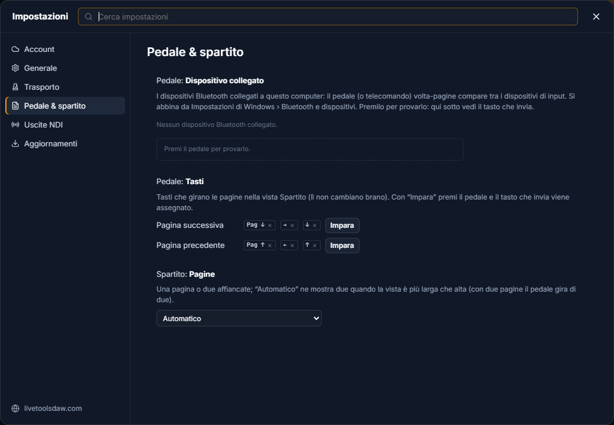

*Impostazioni › Pedale & spartito. La × su un tasto lo toglie; **Impara** aggiunge il tasto che il pedale invia.
“Pagine” sceglie una pagina, due affiancate o “Automatico”.*

### Accordi: sezioni, espressioni e stampa

*Da LiveTools 0.1.11; le stesse funzioni ci sono nell'app web.*

Gli accordi del brano (scheda **Spartito**, campo *Testo e accordi*: ChordPro o accordi sopra il testo) si
dividono in **sezioni** con un'intestazione su una riga sua: `[Strofa 1]`, `[Ritornello]`, `Bridge x2`,
`{start_of_verse: Strofa 2}`. Nel campo allargato (**Allarga**) i pulsanti **Sezioni** sopra il testo la inseriscono dove sta il cursore, già
numerata dopo quelle scritte. Ogni sezione ha una sigla colorata:

| Sigla | Sezione | Sigla | Sezione | Sigla | Sezione |
| --- | --- | --- | --- | --- | --- |
| I | Intro | B | Bridge | Tg | Tag |
| V | Strofa (Verse) | It | Interludio | Bd | Breakdown |
| Pc | Pre-ritornello | Is | Strumentale / Solo | E | Finale (Ending) |
| C | Ritornello (Chorus) | Vp | Vamp | O | Outro |
| Po | Post-ritornello | Ta | Turnaround | | |

Valgono anche i nomi inglesi (*Verse 1*, *Chorus*, *Pre-chorus*…). Se un tipo ha più sezioni, le sigle si
numerano (V1, V2, C1, C2).

I pulsanti di sezioni ed espressioni compaiono solo nel campo allargato; nel campo normale resta il
pulsante **(i)**. Il pulsante **(i)** apre la **legenda**: le sigle con i loro colori e i nomi
accettati, il significato di ogni espressione e come si scrivono intestazioni, espressioni, ripetizioni e
accordi. Si chiude con lo stesso pulsante o con la **×**. Passando col mouse su un'espressione se ne legge il
significato.

- **Espressioni**: i pulsanti **Espressione** (Soft, Build, Full band, Stop, Rallentando…) inseriscono
  `{expr: Soft}`; subito sotto un'intestazione diventa l'indicazione della sezione, altrove una nota a destra.
  In alternativa: `[Strofa 3 | Softly]`.
- **Ripetizioni**: per far tornare una sezione già scritta, riscrivi solo la sua intestazione (es.
  `[Ritornello 1]` senza righe sotto, o `{chorus}`): compare nella **mappa** del brano senza essere ristampata.
  `x2` in fondo all'intestazione la segna come ripetuta.
- Con gli accordi sopra il testo, la riga di accordi si unisce al testo sotto: ogni accordo va sulla sua sillaba.

**Scrivi / Anteprima**: le due schede sopra il campo passano dal testo da scrivere all'anteprima degli accordi
come si leggono (sigle delle sezioni, espressioni, accordi sopra le sillabe). Nell'anteprima i pulsanti **−** e
**+** trasportano di un semitono alla volta, e **Stampa** stampa nella tonalità dell'anteprima.

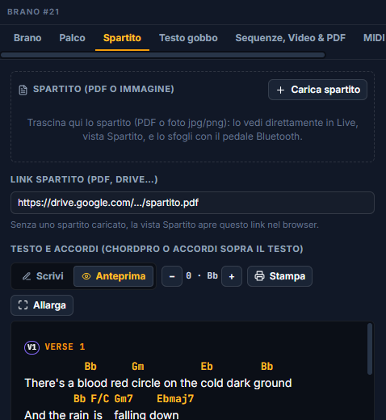

*La scheda **Spartito** dell'ispettore: in alto si carica il PDF o la foto, poi il link, poi “Testo e accordi” in
**Anteprima** (sigla “V1” della strofa, accordi sopra le sillabe, − 0 + per trasportare).*

**Allarga** apre il campo su tutta la finestra, per scrivere più comodamente brani lunghi (con le stesse schede
e gli stessi pulsanti); **Riduci**, **Esc** o un clic fuori dal riquadro lo riportano nella scheda.

**Stampa** (accanto al titolo del campo) stampa gli accordi del brano, o li salva in PDF dalla finestra di
stampa (*Salva come PDF*). Il foglio ha in alto titolo, artista, tonalità, tempo e metro, poi la **mappa** delle
sezioni nell'ordine in cui si suonano (V1 V2 Vp C1… con le ripetizioni), poi le sezioni in riquadri su due
colonne, con la sigla, il nome e l'espressione. In fondo a destra c'è il logo di LiveTools (*Stampato con*). **Stampa accordi** nella barra della pagina Scaletta stampa
tutti i brani della scaletta, uno per pagina, nella tonalità in cui si suonano.

---

## 10. Video

Il video del brano segue l'orologio audio. Si vede nell'anteprima del dettaglio e in una **seconda
finestra** per proiettore o secondo schermo (pulsante nell'Arrangement; doppio clic = schermo intero).
Dalla prossima versione la finestra si apre già a schermo intero, sul secondo schermo se è collegato (doppio clic o
Esc la riportano in finestra); lo stesso vale per la finestra del gobbo, e con tre schermi video e gobbo vanno
su due schermi diversi. Chiudendo LiveTools si chiudono anche le finestre di video, gobbo e mixer.
I pulsanti *Video* / *Uscita video* e *Uscita gobbo* sono interruttori: il primo tocco accende l'uscita, il secondo la
spegne (il pulsante resta evidenziato finché è accesa); lo stesso fanno **F4** (video) e **F6** (gobbo). Così si
nasconde il proiettore dal computer, senza portare il mouse sul secondo schermo.

### Video in scaletta (dalla prossima versione)

Un elemento di tipo **Video** (vedi 3.3) è un video da solo, con il suo suono, che si lega al brano dopo senza stacchi.
Nel Palco la sua tessera ha l'icona del video; il pulsante con i cursori apre, al posto di tonalità e tempo:

- **Entrata** e **Uscita** — dissolvenza dal nero e verso il nero, di immagine e suono insieme (di serie: entrata netta,
  uscita in 3 secondi). Vale per la finestra video e per l'uscita NDI. Nella pagina *Transizioni* (Modifica) immagine e
  audio si possono separare, ciascuno con la sua entrata, uscita e fine: allora qui si regola solo l'immagine.
- **Pad** — quanti secondi prima della fine del video entra il **pad**, nella tonalità del brano dopo: così un brano
  che parte senza intro ha già la sua nota.
- **Nel brano** — quanti secondi il pad continua dentro il brano dopo prima di sfumare; **Sfumatura** è la durata della
  sfumatura (4 secondi se non la cambi). Con *Fino a PAD* il pad continua finché non premi **PAD**. Premere PAD prima
  lo spegne subito e annulla la sfumatura programmata.

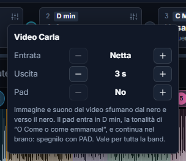

*Il riquadro di un elemento Video. “Nel brano” e “Sfumatura” compaiono quando il pad è acceso.*

Esempio: video d'ingresso, *Pad 20 s prima della fine*, *Nel brano 15 s*, *Sfumatura 6 s*, transizione *AutoLink*.
Gli ultimi 20 secondi del video suonano con il pad nella tonalità del primo brano; il video sfuma al nero, il brano
parte esattamente alla fine del video e dopo 15 secondi il pad sfuma in 6 secondi. Con *Dissolvenza* il brano entra negli ultimi 5 secondi mentre il video sfuma.

### Immagine della scaletta (dalla prossima versione)

Nella barra della pagina **Scaletta**, gruppo *Schermo*, **Immagine…** sceglie un'immagine (JPG, PNG o WebP, fino a
20 MB) da proiettare sull'uscita video quando non c'è nessun video: tra un brano e l'altro, dopo un video, nei brani
senza video. Vale per tutta la band; senza immagine l'uscita resta nera. Passa anche sull'uscita NDI.

### Uscite NDI

Video e gobbo possono andare anche in rete come sorgenti **NDI®**, per vMix, OBS, un mixer video o uno
schermo NDI, senza tenere aperte le finestre di uscita. Si attivano in **Impostazioni › Uscite NDI**:

- **Uscita video** — il video del brano nel player, a tempo con l'audio (prima dell'inizio il primo
  fotogramma, dopo la fine l'ultimo); senza video l'uscita resta nera, o mostra l'immagine della scaletta
  (dalla prossima versione).
- **Uscita gobbo** — la slide del momento e, se attiva, la successiva, a 1920×1080, come nella finestra Gobbo.

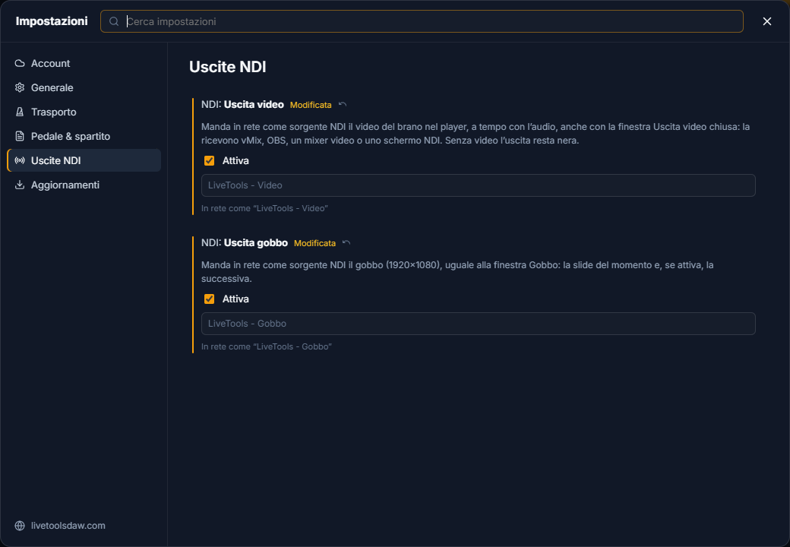

*Impostazioni › Uscite NDI: per ognuna la casella “Attiva”, il nome con cui compare in rete e la compensazione del ritardo.*

I nomi delle sorgenti si possono cambiare; di default sono **LiveTools - Video** e **LiveTools - Gobbo**
(i programmi NDI mostrano davanti il nome del computer: *NOMEPC (LiveTools - Video)*). Serve il runtime NDI: l'installer di LiveTools installa **NDI 6 Runtime** se manca (anche **NDI Tools**,
da [ndi.video](https://ndi.video), lo contiene); se non c'è, le Impostazioni lo segnalano.
Un'uscita accesa lavora solo quando qualcuno la riceve: se nessun programma è collegato non occupa il
processore, e appena un programma si collega riceve subito l'immagine.

**Compensa ritardo**: la rete e il programma che riceve (vMix, OBS, un mixer video) tengono l'immagine per un
attimo, così il video o il cambio di slide arrivano dopo la musica. Sposta il cursore di ciascuna uscita (da 0 a
500 ms, a passi di 10) finché l'immagine non è a tempo con l'audio: LiveTools la manda in anticipo di quel tempo.
Un modo semplice per regolarlo: guarda un punto del video dove si vede bene un colpo (una cassa, un battito di mani)
sul monitor della regia e alza il valore finché immagine e suono non coincidono. Doppio clic sul cursore: 0.

**Calibra col telefono** fa la misura da solo. Collega il telefono o il tablet come telecomando (*Rete locale ›
Telecomando*), ferma il brano e premi *Calibra col telefono* sotto l'uscita: sul telefono si apre la fotocamera.
Inquadra lo schermo che riceve l'uscita NDI (basta una parte), stando dove senti bene le casse, e premi *Inizia*.
L'uscita fa 8 lampi bianchi e ogni lampo ha un bip nelle casse (a volume moderato, su tutte le uscite audio): il
telefono misura di quanto il lampo arriva dopo il bip e LiveTools imposta la compensazione. Durante la prova l'uscita
mostra nero al posto del video o del gobbo, quindi falla prima del concerto. Se le misure variano molto, ripetila
tenendo il telefono fermo; il cursore resta sempre regolabile a mano.
Il video viene decodificato con i codec di Windows (MP4/H.264 e gli altri formati che Windows legge).

<small>NDI® is a registered trademark of Vizrt NDI AB.</small>

---

## 11. Problemi frequenti

| Problema | Cosa fare |
|---|---|
| Il login non torna all'app | chiudi la scheda del browser e riprova; controlla che nessun firewall blocchi 127.0.0.1 |
| Un brano non suona offline | **F7** (controllo pre-concerto) o nel Browser controlla lo stato dei media e scaricalo di nuovo |
| Il click non è a tempo con la traccia | menu **Griglia**: scegli un'altra traccia di riferimento, oppure **Griglia a mano** |
| Nessun suono su un'uscita | controlla la matrice uscite: le uscite che la scheda non ha vanno su Out 1-2 |
| File AIFF non suonano sul web | normale: Chrome non legge l'AIFF, usa il desktop |
| L'aggiornamento non compare | Impostazioni › Aggiornamenti › *Cerca aggiornamenti* (serve la rete) |
| La sorgente NDI non compare | Impostazioni › Uscite NDI: controlla che non segnali il runtime mancante; il computer che riceve dev'essere sulla stessa rete (e il firewall non deve bloccare LiveTools) |
| *Impossibile creare l'uscita NDI* | sullo stesso computer c'è già una sorgente con quel nome, di solito un'altra copia di LiveTools aperta (anche nell'area di notifica): chiudila o cambia il nome. L'uscita riprova da sola ogni 3 secondi |
| Le tastiere non cambiano suono | Ctrl+, › MIDI: scegli l'uscita (o *Aggiorna* dopo averla collegata), lascia attivo il cambio automatico e prova con *Invia ora*; controlla il canale nella scheda MIDI del brano. Se un altro programma usa l'interfaccia, chiudilo |
| Senza internet la band non segue il brano | Tutti sulla stessa rete Wi-Fi e sulla stessa scaletta; Ctrl+, › Rete locale deve dire *Guidi la band* su chi guida. Se chi segue resta su *Cerco chi guida…*, scrivi a mano l'indirizzo mostrato da chi guida e controlla che Windows consenta LiveTools sulle reti private |
| Il controller MIDI non comanda niente | Ctrl+, › MIDI › Ingressi: l'ingresso deve risultare *In ascolto* (se un altro programma lo usa, chiudilo e premi *Aggiorna*); in MIDI learn controlla che il controllo abbia il suo messaggio |
| L'audio salta o il computer è lento | controlla i *Requisiti del computer* (capitolo 1); chiudi gli altri programmi, collega l'alimentatore (a batteria Windows rallenta il processore) e, se proprio serve, passa alla vista Spartito o Gobbo, che pesano meno |
| Il pedale non gira le pagine | Impostazioni › Pedale & spartito: controlla che sia tra i dispositivi collegati, premilo e usa *Impara* |

## 12. Dove sono i dati

- Scalette, brani, griglia, gobbo, cue, mix delle tracce (volumi, mute, automazioni), cambi di tempo: online, nel cloud di LiveTools, condivisi con la band.
- Media scaricati, cartella media, uscite, volumi e mute dei gruppi Rehearsal, scelte del menu Griglia: solo su questo
  computer (`%APPDATA%\it.lecaractere.livetools\` su Windows).
